

<a href="README.md">简体中文</a> | English

# CicaTavern

**An agent-style player for SillyTavern character cards.** Import the character cards, world books and presets you already use, and play them with **your own model API** (DeepSeek, OpenRouter, Anthropic, OpenAI, Gemini, a local Ollama and more).

- **High cache hit rates**: long stories stay cheap, and replies start fast.
- **Long-term memory**: what was compacted away comes back when the story brings it up.
- **SillyTavern-compatible**: cards, world books, presets, regex, MVU variables and status bars work as imported.
- **Pictures and read-aloud**: illustrate a scene with one click; dialogue and narration each get their own voice.
- **Visual novel and game rules**: the story becomes a game screen, with dice checks and turn-based fights.
- **A guided card creator**: it asks you step by step and writes a complete card at the end.

Runs on Windows, Mac, Android and iPhone, in English or Simplified Chinese, and everything stays on your own device.

<b><a href="https://github.com/Shikasar7/CicaTavern/releases/latest">Download</a></b> · <a href="docs/guide.en.md">User guide</a> · <a href="docs/help/README.md">Help (Chinese)</a> · <a href="CHANGELOG.md">Changelog (Chinese)</a>

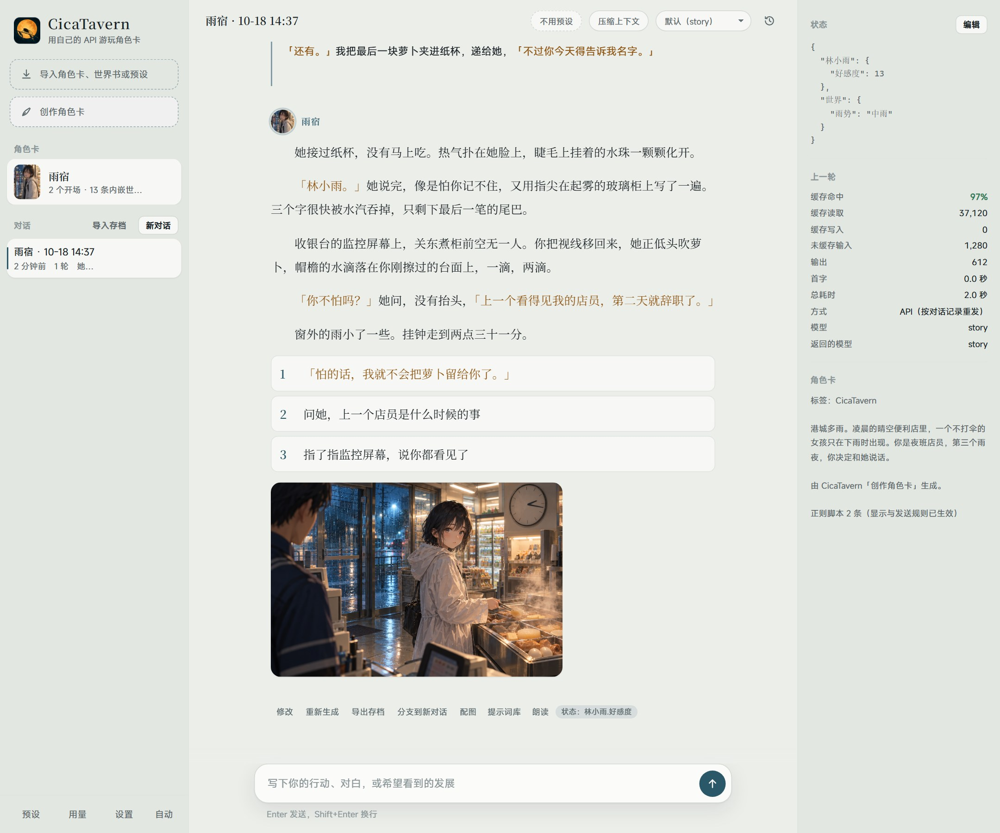

## Features

### High cache hit rates

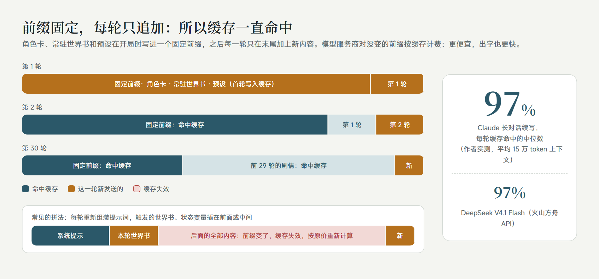

The card, world books and preset sit in a fixed prefix and each turn only appends, so a long chat hits the cache for over 90% of every turn.

### Long-term memory (Beta)

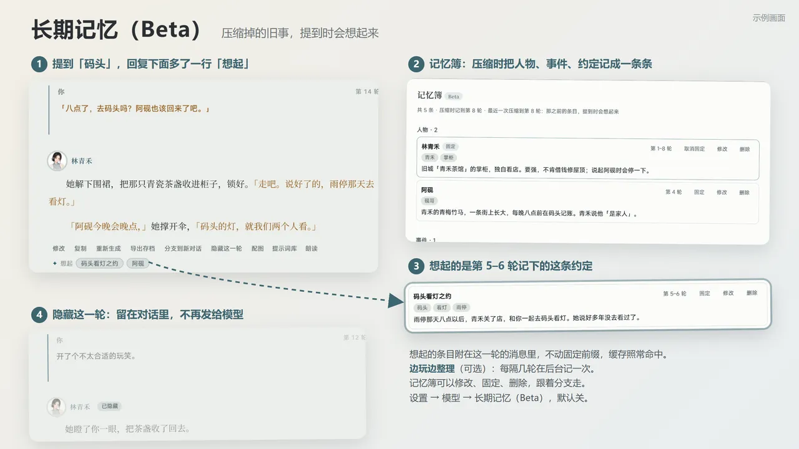

People, promises and foreshadowing from older parts of the story go into a memory book and come back when the story mentions them, without breaking the cache or needing any extra API.

### SillyTavern-compatible

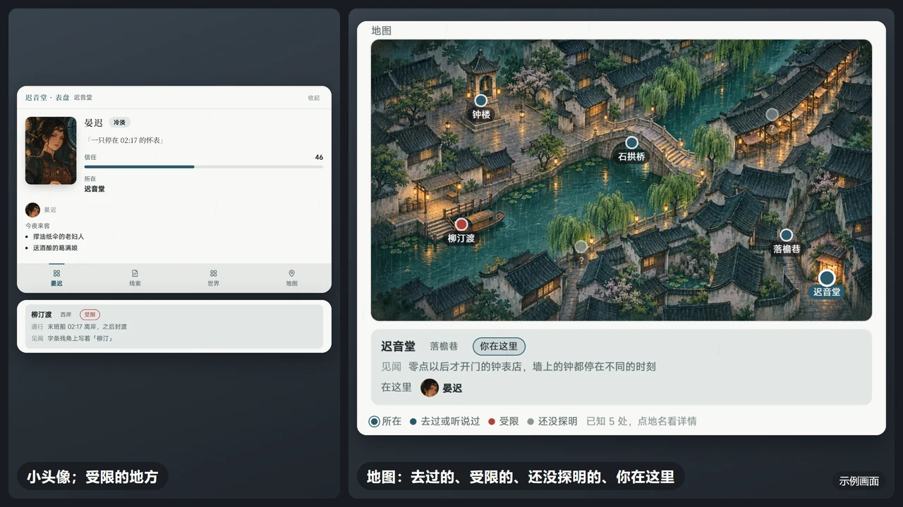

SillyTavern cards, world books, presets, regex, MVU variables, the status bars inside cards and Tavern Helper scripts all work, and SillyTavern chats import directly.

### Visual novel mode

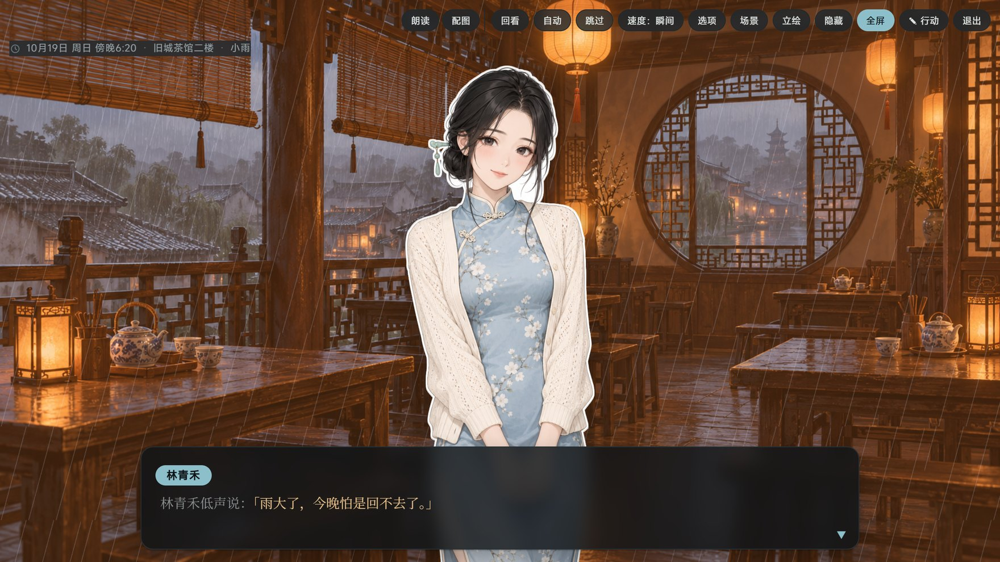

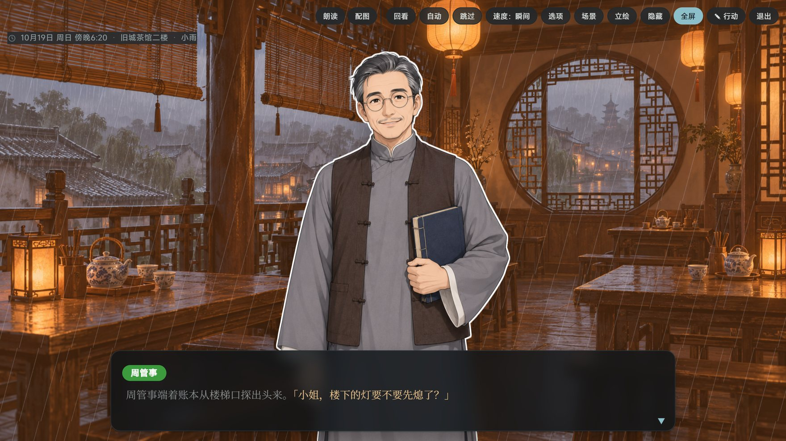 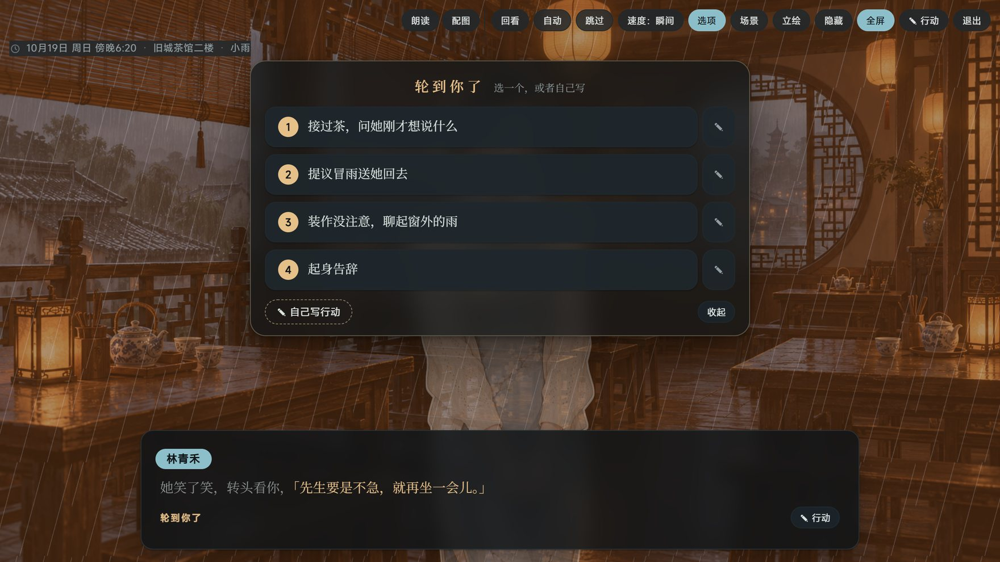

One switch turns the story into a game screen: scene backgrounds, the speaker's sprite, one line at a time, and the choices in the middle of the picture.

### Game rules mode (in development)

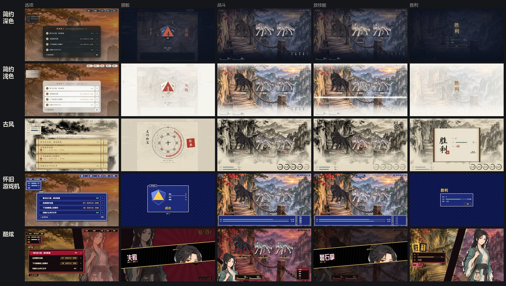

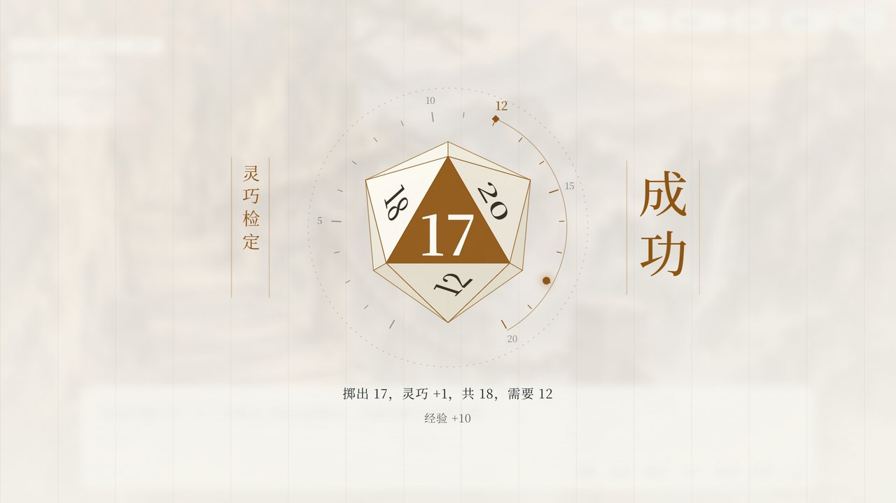 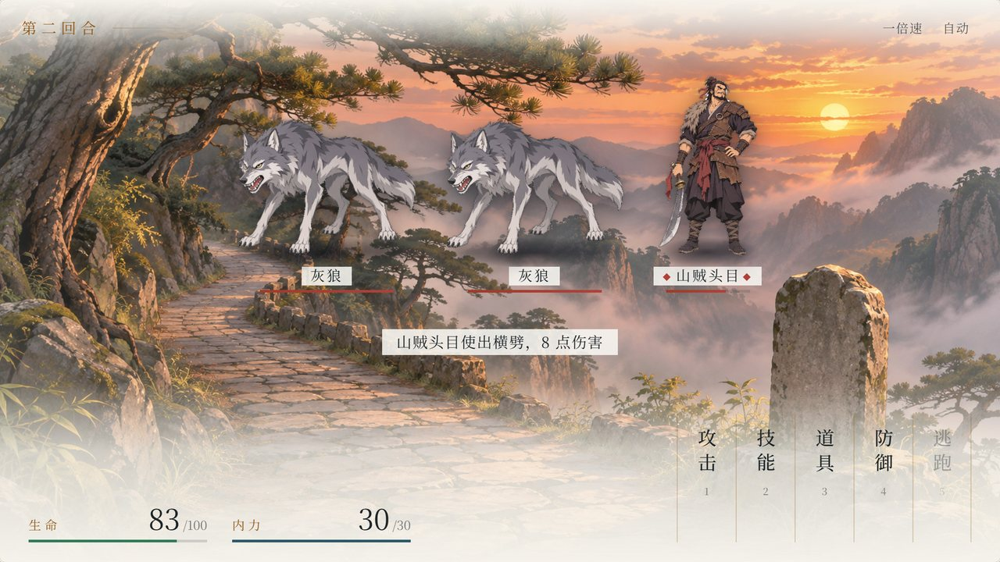

Dice checks, turn-based fights, levels and growth: the program decides what happens and the model writes it. On per card, off by default.

### Pictures, voices and characters that keep their look

Illustrate a scene with one click through an OpenAI-compatible API, Gemini, NovelAI, ComfyUI or SD WebUI. Read-aloud uses cloud voices, the browser's voices or a local model, and you can speak your messages too. Each character's face, outfit and voice are kept, so they stay the same person in every picture.

### Guided card creator

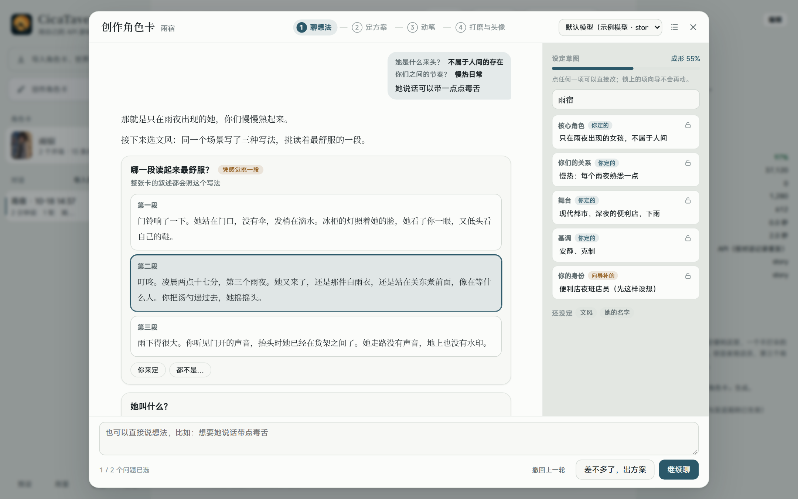

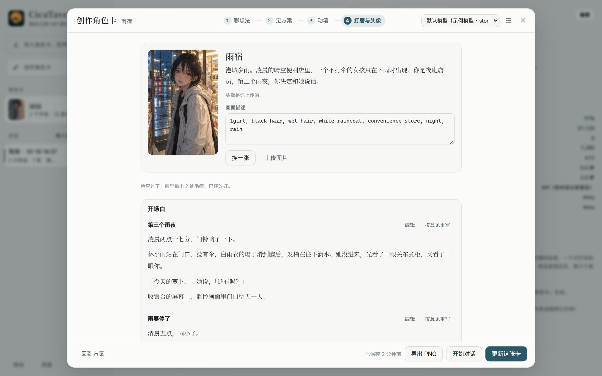

Not sure what you want yet? The creator asks you round by round, settles a plan with you, then writes the world book, greetings and status bar. The exported PNG works in SillyTavern too.

### On your computer and your phone

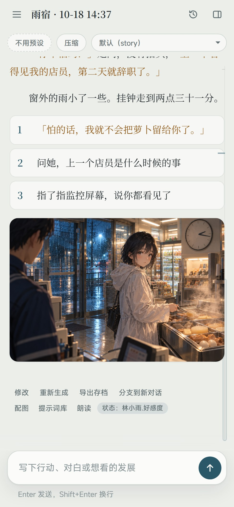

- With the computer on, open the passcode link in your phone's browser and play.
- Or install the Android app, or the iPhone and iPad [beta](https://testflight.apple.com/join/wsT7kT4b), and play without the computer.
- The interface is laid out for phone screens.

 

## Getting started (Windows)

1. Download the zip, unzip it anywhere and double-click **CicaTavern.exe**. If Windows says "Windows protected your PC" the first time, click **More info → Run anyway**.
2. At the bottom of the model picker in the top bar, choose 管理模型供应商… (Manage providers) → 添加 (Add) → 从模板开始 (Start from a template), pick a provider and paste your API key.
3. Top left, 导入角色卡、世界书或预设 (Import card, world book or preset): choose a SillyTavern card, then 新对话 (New chat).

Installing on Mac, Android and iPhone, and the full notes on updates, proxies, pictures, read-aloud, privacy and more, are in the **[user guide](docs/guide.en.md)**.

## Support the project

Building CicaTavern has taken over 20 billion tokens so far, and since October it has shipped 50+ versions in about a month.

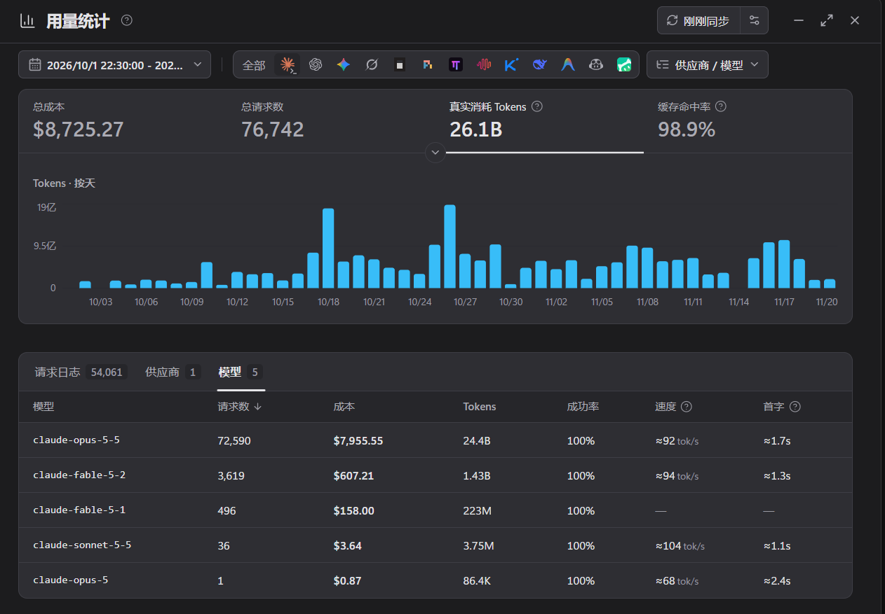

If you're having fun and would like to support the author, you can buy them a bubble tea. Thank you so much! With your support the updates will come even faster (ง •̀_•́)ง

Thank you all for your love and feedback; you are what keeps me going~

## License

[GNU AGPL-3.0](LICENSE), copyright Shikasar7. Free to use, commercial use included; a modified version you distribute must be open source too. Before contributing code, please read [CONTRIBUTING.md](CONTRIBUTING.md).

This project is not affiliated with Anthropic, OpenAI, Google or any other model provider; costs are billed to your own account. Character cards, world books and presets belong to their original authors.
