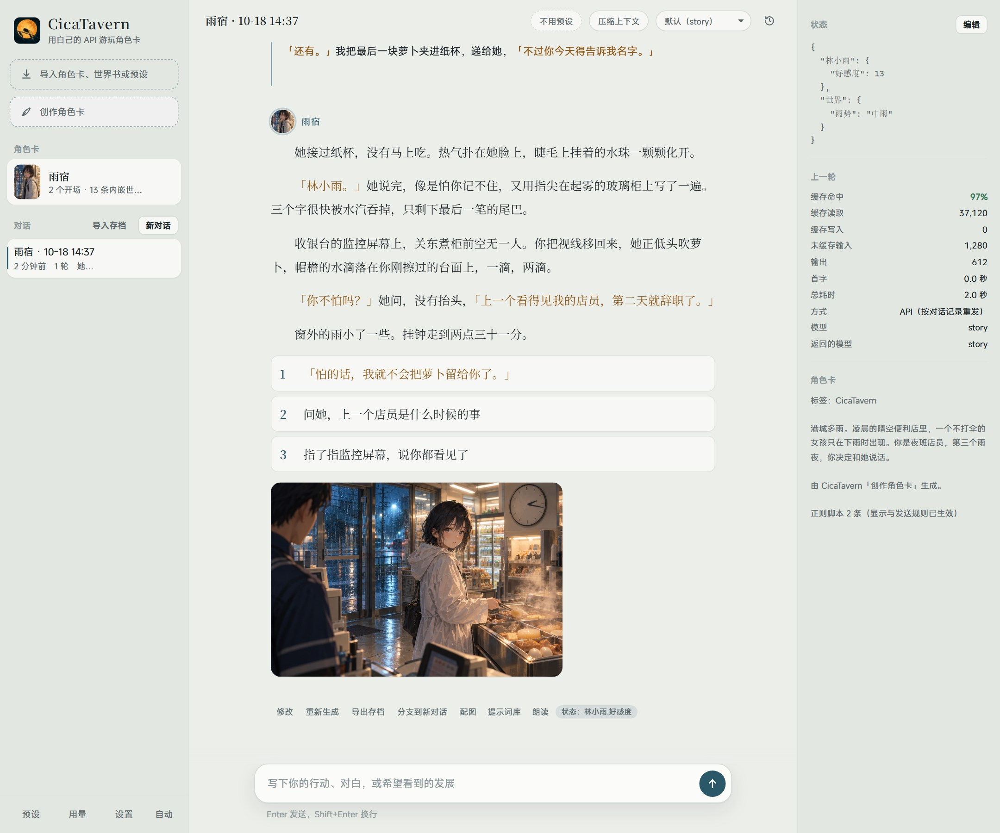
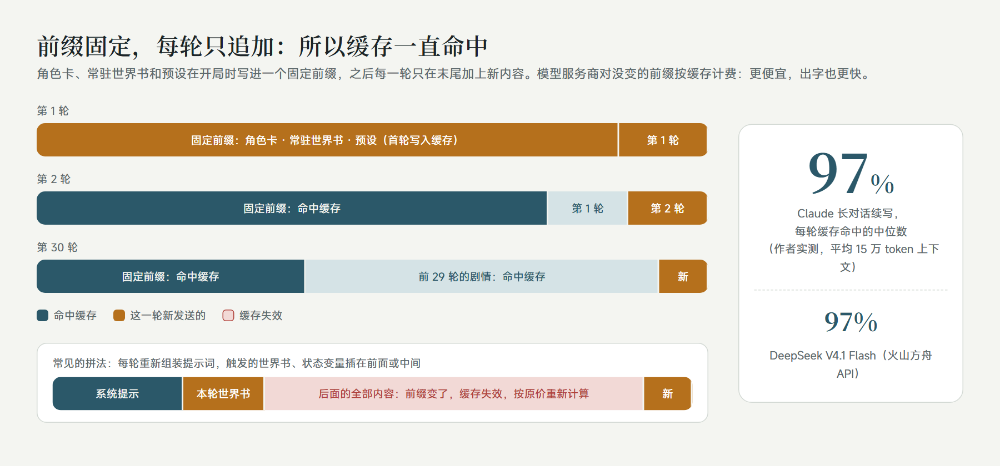
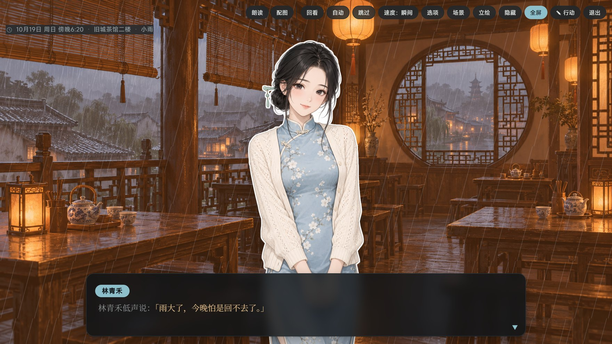
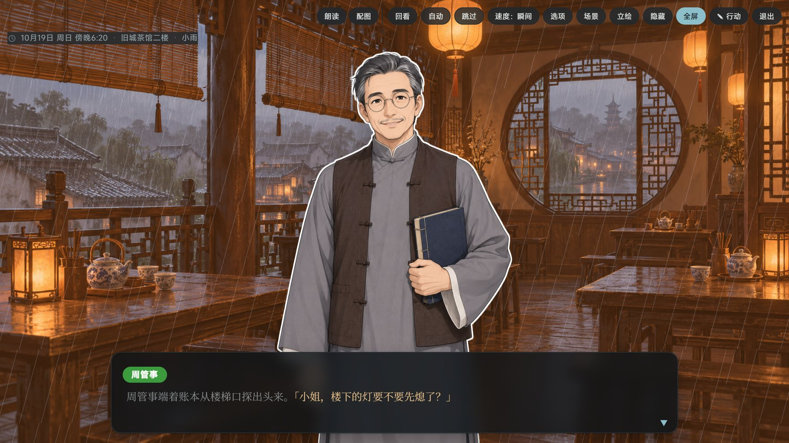
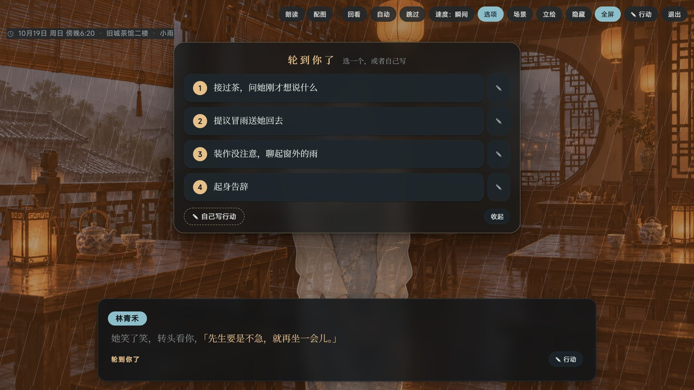
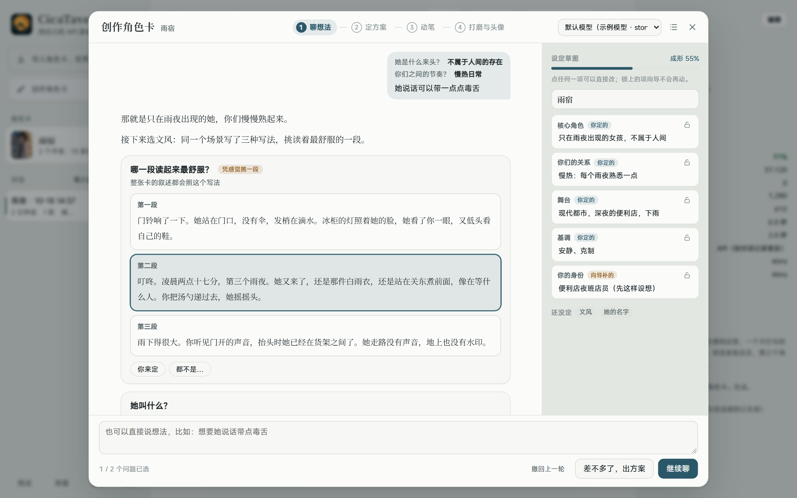
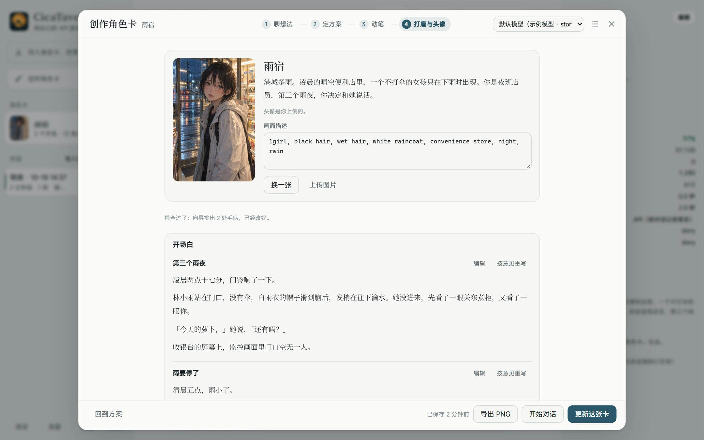
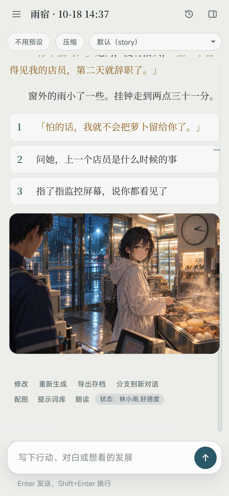
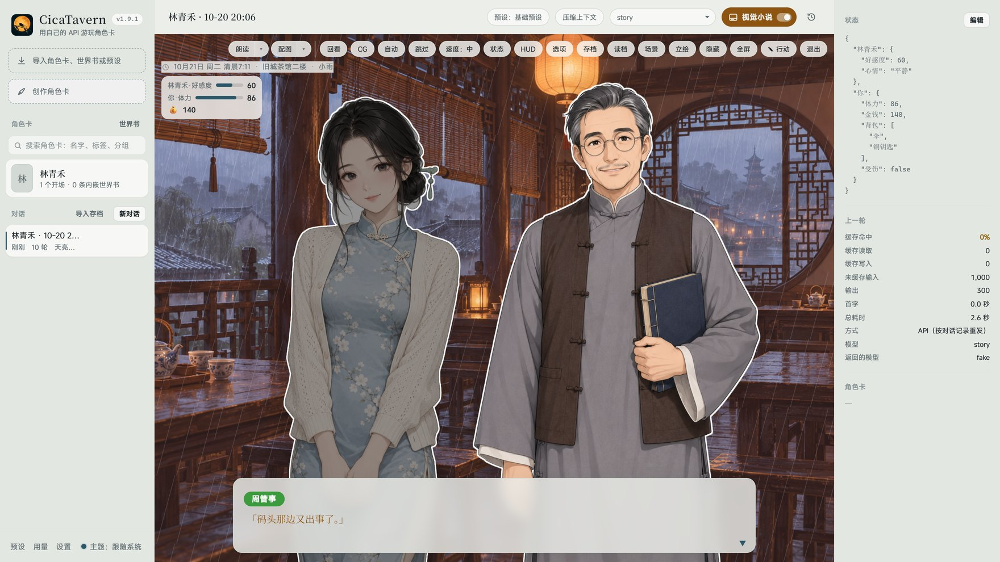

<p align="center"></p>

<p align="center"><a href="README.md">简体中文</a> | English</p>

# CicaTavern

**An agent-style player for SillyTavern character cards.** Import the character cards, world books and presets you already use, and play them with **your own model API** (DeepSeek, OpenRouter, Anthropic, OpenAI, Gemini, Kimi, Zhipu, Qwen, Volcano Engine Ark, a local Ollama, and more):

- **High cache hit rates**: prompts are built around the provider's cache, so in a long story most of every turn is billed at the much cheaper cached rate, and replies start faster.
- **SillyTavern-compatible**: character cards, world books, presets, regex scripts, MVU variables and the status-bar UIs inside cards work as imported.
- **Pictures and read-aloud built in**: illustrate a scene with one click; dialogue and narration each get their own voice, and you can tap any line to hear it.
- **Visual novel mode**: turn the story into a game screen with one switch — scene backgrounds, the speaker's sprite, a name plate, one line at a time, and the choices in the middle of the picture.
- **Characters keep their look**: every character's face, outfit, reference picture and voice are kept, so they stay the same person however many pictures you make.
- **A guided card creator**: not sure what you want yet? The creator asks you step by step and writes a complete card at the end.

Unzip and run on Windows; there is an Android app too. Everything stays on your own device.

> The interface comes in English and Simplified Chinese (since 1.5.0). It follows your system language; to switch, open Settings → More → 界面语言 · Interface language. Menu names below are given in Chinese with an English gloss, which may be worded a little differently from the English interface.

<p align="center"></p>
<p align="center"><sub>Example screenshot: this card was made with the card creator, and the illustration was drawn from the story by an image API.</sub></p>

## Why CicaTavern

### Agent-style: more than a chat box

The model takes care of several jobs in the background while you play:

- **Generation runs in the background**: switch to another chat or reload the page, and the turn still finishes.
- **Models share the work**: for a picture, a helper model reads the scene and writes the image prompt from the character roster; "compress context" (压缩上下文) has the model write the story so far into a save (characters, events, foreshadowing, style) and carry on in a clean context; the card creator plans, drafts, reviews and revises.
- **State updates itself**: variable updates at the end of a reply (MVU format) are parsed and shown in a status bar under the latest reply (numbers as bars, with this turn's change); you can also edit them by hand in the right panel.

### High cache hit rates: long stories stay cheap and fast

<p align="center"></p>

The card, the always-on world book entries and the preset go into a fixed prefix when a chat starts; after that, each turn only appends to the end. Everything that changes (triggered world book entries, state variables, the per-turn reminder) goes last, so the cached part in front is never touched. The Anthropic API gets cache breakpoints automatically; DeepSeek, OpenAI and similar APIs cache an identical prefix on their own.

From the author's own long chats (October 2026):

| Model | Average context | Turns counted | Cache hit per turn (median) |
|---|---|---|---|
| Claude Opus 5.5 | about 150k tokens | 84 | 97% |
| Claude Sonnet 5.5 | about 60k tokens | 51 | 93% |
| DeepSeek V4.1 Flash (Volcano Engine Ark API) | about 70k tokens | 13 | 97% |

<sub>The two Claude rows come from the author's personal build, which sends the same prompt structure through Claude Code; with the Anthropic API, CicaTavern sets cache breakpoints the same way. Real hit rates also depend on the provider: some third-party relays count caching differently and hit less. Every turn's cache hit and cost are shown in the right panel and in the usage panel (用量).</sub>

### Works with SillyTavern cards, world books and presets

- **Character cards**: SillyTavern V1/V2/V3 PNG and JSON, with embedded world books, regex scripts and alternate greetings. A new version of a card can replace the old one in place, keeping your chats.
- **World books**: always-on and keyword entries, with regex keys, secondary keys, probability and insertion position. Standalone world books can be attached to a card, and after import every entry can be searched, switched on or off and edited under View entries (查看条目).
- **Regex**: the regex scripts in cards and presets work as they are. Settings → Writing → Regex also holds global scripts and regex sets: a set works only on the cards you put it on, after the card's own scripts. Each script has a test box, and a whole group or the scripts you select can be exported as SillyTavern regex files, copied, moved or switched on and off together.
- **Presets**: a light built-in "Basic preset" with switches for point of view, style, not acting for you, limited knowledge, dark themes, intimacy, choices (tap to send) and a time box, so it plays well without importing anything. You can also import Chat Completion presets, toggle and edit their entries, and pin the ones you use most as quick switches.
- **MVU variables and status bars**: `[InitVar]`, `<UpdateVariable>` / JSONPatch and the older `_.set()` are supported; EJS templates run in a QuickJS sandbox (with ST-Prompt-Template's `getwi`, `matchChatMessages` and the like). HTML UIs inside cards render in isolated iframes, with a compatibility layer for the common Tavern Helper (酒馆助手) functions: variables, lorebooks (changes kept for that chat only), calling the model (each card asks first) and sending messages. The libraries those UIs need, such as jQuery and Vue, load from jsDelivr, so some may be missing offline.
- **SillyTavern chats**: import a .jsonl (drop it into the window or use Import archive) with every turn, every swipe and the MVU variables; a long one can be compacted into a story archive first.
- **Web search**: the globe left of the input box turns it on per chat. It uses the provider's own search, like SillyTavern's "Enable web search": Claude on the Anthropic interface, the OpenAI Responses interface and OpenRouter models have it. When real-world facts are needed the model searches first and then writes; what it searched for and the pages it cited are listed under the reply. Searches cost extra.
- **Blocked words**: Settings → Writing → Blocked words removes words, masks them with `*` or swaps them for words you choose, both in what the model is sent (card, preset, lorebooks, history and your messages) and in the replies shown; each word can be switched on or off and kept to one side. Only the copy being sent or shown changes, so switching a word off brings it back; Chinese has no spaces between words, so longer words to leave alone go under Exceptions. After a change, chats that use the word write the cache again from where it appears, and saving tells you from which turn.
- **Personas and styles**: Settings → Writing keeps your personas and writing styles as lists you can add to, copy, import and export. Personas move to and from SillyTavern's Persona Management (restore the exported file there, or import its backup here); a style exports as a SillyTavern system prompt, and a plain text file of rules imports as one. Each card can pick its own persona and style, otherwise it uses the defaults; a chat keeps the ones it started with until you click "Use in this chat", and the next turn writes the cache once more. Exported cards never carry your persona.
- **Versions and branches**: regenerate, swipe between versions, branch from any message, roll back, edit any message; a whole chat can be packed up and moved to another device.

### Pictures and read-aloud

- **Pictures**: one click, and a helper model writes the image prompt from the scene, the characters' looks and the card's art style; you can review it before drawing. Backends: an OpenAI-compatible image API (gpt-image and others), Gemini's own image models, NovelAI, or a local ComfyUI workflow or SD WebUI / Forge. New replies can be illustrated automatically. Prompts you have drawn are kept in a prompt library.
- **Read-aloud**: quoted dialogue uses the dialogue voice and everything else the narrator voice; tap a line in the story to hear just that line. Voices can come from cloud services such as Fish Audio, MiniMax, Gemini or any OpenAI-compatible speech API, the browser (free), or a TTS model on your computer or local network; everyone in the cast can have a voice of their own. Audio is cached once read. New replies can be read automatically.
- **Voice input**: speak into the microphone beside the input box and the words go into the box for you to read before sending. A provider's transcription API (SiliconFlow's SenseVoice is free), whisper on your own computer, or the browser's built-in recognition turns them into text.

### Visual novel mode

<p align="center"></p>
<p align="center"> </p>

- **One switch**: turn on Visual novel in the top bar and the latest reply plays like a game; remembered per card. What the model is sent never changes, so the cache is untouched.
- **Sprites**: whoever speaks steps forward and steps back during narration. White-background reference pictures in the roster are cut out and outlined; anyone without one gets a half-body sprite drawn from their looks.
- **Scenes**: when the story reaches a new place, an empty scene is drawn as the background and reused whenever the story returns; time of day and weather are tints and rain or snow over it.
- **Speakers and dialogue**: who speaks is told even from "she said" or a nameless innkeeper; each name plate has its own colour, and dialogue is coloured apart from narration.
- **Plays like a game**: the choices open in the middle of the picture and number keys pick them; backlog, auto, skip, full screen and line-by-line reading are all there, and the ▾ beside Read and Pictures changes voices, models and drawing without leaving.
- **CG gallery**: every picture on the storyline in one place, each marked with its turn, to browse full size.

### Characters keep their look

- **Character roster**: each character's fixed face, everyday outfit, a reference picture and a LoRA. When several characters share a picture, each is described separately, so faces don't blend.
- **Each card's own art style and negative prompt**, added to every picture for that card.
- **Redraws keep the earlier pictures**: when a picture, reference image, sprite or expression, scene or avatar is redrawn or replaced, each keeps its last few (5 by default; set in Pictures & voice → Image backend) in a row beneath it: click one to bring it back, delete the ones you don't want.
- **Each card's own dialogue and narrator voices**.
- Cards made with the card creator get their roster built automatically.

### Guided card creator

<p align="center"></p>

If you can't quite say what you want, the creator guides you round by round:

1. **Talk it through**: each round it says how it understands your idea, then asks the two or three questions that matter most. Every option comes with a line the character might say, so you can pick by feel; the writing style is chosen from short samples. The sketch beside it updates with your choices; you can edit or lock any part.
2. **Settle the plan**: characters, setting, style, status bar, greetings and world book entries at a glance. Anything the creator filled in for you is listed separately; write a sentence wherever you want a change. Which values the status bar tracks, how they show and how they change can be edited directly, with a live preview; the finished card has the same status bar in SillyTavern.
3. **Write**: the full world book and greetings are written in a few steps from the plan, then checked for clichés and contradictions and fixed.
4. **Polish and portrait**: edit any part directly, or write a note and let the creator rewrite it. The portrait is drawn by your image backend from the character's looks, or you can upload one. Save to start playing, or export a PNG that SillyTavern imports directly.

<p align="center"></p>

### On your computer and your phone



- On the same Wi-Fi or over Tailscale, open the passcode link in your phone's browser and play with the models and data on your computer.
- Or install the Android app, which runs on the phone by itself, no computer needed.
- On iPhone (Safari) or Android (Chrome), add the link to the home screen: it opens full screen like an app, no passcode to type again.
- The interface is laid out for phone screens, and the settings windows are grouped menus.

<br clear="right">

## Latest changes [2.0.0]

<p align="center"></p>

- **Voice input**: a microphone beside the input box turns what you say into text in the box, for you to read and send. Nothing to install: a provider's transcription API (SiliconFlow's SenseVoice is free), the desktop browser's own recognition, or a whisper server of your own; CicaTavern keeps no recordings.
- **Draw history**: illustrations, reference pictures, sprites and expressions, scenes and a card's avatar keep a few old versions after a redraw (5 by default); tap one to use it again, or delete it.
- **Regex sets**: the regex window works like the lorebook one, with copies and SillyTavern exports, and regex sets can run on chosen cards only.
- **Personas and writing styles as lists**: copies and SillyTavern imports and exports, and each card can pick one of each.
- **macOS test build (beta)**: the release page has packages for Apple silicon and Intel. They have not been fully tried on a real Mac yet and are not signed by Apple, so the first time you open the app, go to System Settings → Privacy & Security and click Open Anyway. Reports are welcome.

1.9 added web search, blocked words, card UIs that call the model and edit lorebooks, an error log, the visual novel HUD and speaker marks, editing lorebooks and presets by chat, and an update mirror in China; visual novel mode came in 1.8. Download from [Releases](https://github.com/Shikasar7/CicaTavern/releases/latest); 1.4.0 and later can update in the app. Everything that changed is in [CHANGELOG.md](CHANGELOG.md).

## Getting started (Windows)

1. Unzip anywhere (paths with Chinese characters are fine).
2. Double-click **CicaTavern.exe**. It starts the server in the background and opens an app window (Edge or Chrome, without an address bar). The first time, it lists what it connects to (see [Privacy](#privacy)). For a desktop icon: 设置 (Settings) → 更多 (More) → 桌面快捷方式 (Desktop shortcut).
3. First use: at the bottom of the model picker in the top bar, choose 管理模型供应商… (Manage providers) → 添加 (Add) → 从模板开始 (Start from a template), pick a provider, paste your API key, and click 从接口获取模型列表 (Fetch model list) to check the connection. Then choose a default model in 设置 (Settings).
4. Top left, 导入角色卡、世界书或预设 (Import card, world book or preset): choose a SillyTavern PNG or JSON card, then 新对话 (New chat).

The Node runtime comes with it (`runtime/node.exe`); nothing else needs installing. About a minute after every page is closed, the background server exits by itself; 设置 → 停止后台服务 (Stop the background server) stops it at once.

**CicaTavern.exe is not code-signed.** Windows may say "Windows protected your PC" the first time: click **More info → Run anyway**. It won't ask again, and versions downloaded by the in-app updater don't ask either (see [Code signing](#code-signing)). CicaTavern.exe is a very small program (source in `launcher/`) that does two things: runs `runtime\node.exe bin\launch.mjs` without a console window, and creates the desktop shortcut through Windows' own interface. `runtime\node.exe` is the official, signed Node.js. There are no script launchers in the package. To see the server's output, start it with 排查问题（带控制台）.cmd (troubleshooting, with a console).

## Updates

设置 (Settings) → 更多 (More) → 更新 (Update): when CicaTavern opens, it checks GitHub at most once a day for a new version and shows "有新版本 x.y.z" (new version available) with the release notes here. Automatic checks can be turned off; 检查更新 (Check for updates) works any time. When GitHub can't be reached or hasn't answered within a few seconds (common in mainland China), it asks the mirror at [cnb.cool](https://cnb.cool/cicatavern/CicaTavern/-/releases) instead: the same files under the same version, and the release information there is used only with the publisher's Ed25519 signature. The package can come from GitHub or the mirror; both are checked against the same SHA-256.

1. 下载更新 (Download update): downloads the Windows package and checks it against the SHA-256 published with the release, throwing it away on a mismatch. It is unpacked next to the current folder (for example `CicaTavern-1.5.0-win-x64` beside `CicaTavern-1.4.0-win-x64`). The download uses your proxy setting.
2. 重启并更新 (Restart and update): the server restarts on the new version and the page reloads. Only once the new version is up are the desktop and Start-menu shortcuts pointed at the new folder; the old folder's CicaTavern.exe also forwards to the new version. If the new version fails to start, the old one comes back and nothing changes.
3. The old version's folder stays: 回到上一版 (Back to the previous version) switches back; once you're happy with the new version, delete it under 旧版本文件夹 (Old version folders).

Your data lives in `%USERPROFILE%\.cicatavern\`, outside the program folder, so updating, switching back or deleting old versions never touches it. The updater only downloads the zip from this project's GitHub Releases (or their copy on the mirror in China) and unpacks it itself; it never runs a downloaded installer and uses no PowerShell or scripts. You can still update by hand: unzip the new version into a new folder, double-click its CicaTavern.exe, and add the desktop icon again under 设置 → 更多 → 桌面快捷方式.

## Proxy

If you need a proxy for overseas APIs (OpenRouter, Anthropic, OpenAI, Gemini and so on), choose one under 设置 (Settings) → 网络代理 (Network proxy):

- **不用代理** (No proxy, the default)
- **跟随系统代理** (Follow the system proxy): reads Windows' proxy setting, which is what tools like Clash or v2rayN set in "system proxy" mode. It is re-read every minute, so switching your proxy tool on or off needs no restart.
- **指定代理地址** (A proxy address): for example `http://127.0.0.1:7890`. HTTP proxies only, not SOCKS (most proxy tools' mixed port accepts both).

Providers set to 直连 (direct) skip the proxy: DeepSeek, Kimi, Zhipu, Qwen, Volcano Engine Ark and the other mainland China services in the templates are direct by default.

## Pictures

Pick a backend under 配图与朗读 (Pictures and voice) → 画图方式 (How to draw):

- **OpenAI-compatible image API**: choose a provider you've added and its image model (gpt-image, grok, SiliconFlow and others); the portrait or a reference picture can be used as a reference. With OpenRouter as the provider, its image models (`google/gemini-…-image` and others) are used.
- **Gemini's own image models** (Nano Banana): choose the provider made from the "Gemini" template; the model defaults to `gemini-2.5-flash-image`, or try `gemini-3-pro-image-preview`. Reference pictures of cast members in the frame are sent along, so faces stay the same.
- **ComfyUI**: import a workflow saved with "Export (API)", with placeholders marking the prompt, size and so on. `examples/comfy-illustrious-api.json` is a text-to-image example; change the model name to your own.
- **NovelAI**: enter a persistent token. V4.5 / V5 and character references are supported; the best choice for anime.
- **SD WebUI / Forge**: AUTOMATIC1111, Forge or reForge on your computer (started with `--api`), drawing with the model loaded there; sampler, steps, CFG and negative prompt can be set, and a cast member's or the card's LoRA goes into the prompt as `<lora:…>`.

While the image backend isn't set up (no provider, no token), its row in Pictures and voice stands out.

The helper model that writes image prompts is chosen here too. With a card selected, the same window sets that card's art style, negative prompt and character roster.

## Read-aloud

In 配图与朗读 (Pictures and voice), choose each card's 对白音色 (dialogue voice) and 旁白音色 (narrator voice): quoted dialogue uses the dialogue voice and the rest the narrator voice (no narrator voice means narration isn't read). Everyone in the card's cast can also have a voice of their own: visual novel mode reads each line in its speaker's voice, and so do Read aloud and tapping a line in the chat, with the dialogue voice for anyone without one. Tap a line of dialogue to hear just that line. Voices come from three kinds of source, all set under 配图与朗读 → 朗读来源 (Voice sources), each with a 试听 (preview) button that works before saving:

**Cloud services** (need a key, billed per character, on your own account)

- **A provider's speech API**: choose a provider you've added and enter the model and voice. It uses the provider's OpenAI-compatible `/audio/speech`, with the provider's address, key and proxy setting. OpenAI: `gpt-4o-mini-tts` (adjusts the delivery to the emotion in the reply). SiliconFlow: `FunAudioLLM/CosyVoice2-0.5B`; leave the voice box empty to list its preset voices. Local OpenAI-compatible wrappers such as Kokoro or GPT-SoVITS go here too; they run locally and cost nothing.
- **Fish Audio**: enter your API key (saved when you leave the box or press Enter) and paste the links of voices you like (`fish.audio/m/…`) into the voice box, optionally followed by a space and a name; for voices you cloned yourself, click 从账户读取音色 (Read voices from account). Emotions in the reply are passed as tone tags before the line.
- **MiniMax**: enter your API key and choose the mainland or international site (a key only works on the site that issued it). Leave the voice box empty for the system voices; for cloned or designed voices, click 从账户读取音色 or enter a voice_id.
- **Gemini speech**: choose the provider made from the "Gemini" template (it shares the key and proxy with chat); the model defaults to `gemini-2.5-flash-preview-tts`. Leave the voice box empty to list Google's 30 prebuilt voices (Kore, Leda, Puck, Charon…), which read Chinese too; emotions in the reply become a spoken-style prompt before the line.

**Browser** (built into the device, free, works out of the box)

- The voices depend on the browser and system. Browser voices belong to each device: where a device doesn't have the same voice, its default Chinese voice is used.

**Local voice bridge** (a TTS model on your computer or local network, nothing goes to the cloud)

- Enter its bridge address. The service needs `POST /api/tts` (`{ "text", "voice" }` → audio) and `GET /api/persona/list` (`{ "voices": [{ "name" }] }`).
- On a phone, paste the whole link from the computer's CicaTavern (设置 → 手机访问, Phone access) to use the voices set up there (the cloud keys stay on the computer).

Fish and MiniMax keys are kept in the data folder's `voice-keys.json`; the page only ever sees the last four characters. Audio is cached in the data folder's `media/tts/` and made again when you change the voice or model; if a line sounds wrong, click 重新合成 (Synthesize again) on the progress bar. When a card has no dialogue voice and a local voice bridge is set, the bridge's current voice reads.

## Voice input

The microphone right of the input box: click it and speak, then click it again (or click 完成, Done) when you finish. What you said goes into the input box at the cursor for you to read and edit; it is never sent by itself. While recording, the strip above the input box shows the time and 取消 (Cancel); Esc cancels too, and clicking the microphone while it transcribes cancels that. A recording is at most 3 minutes, and one in which nothing was heard isn't sent.

The first click opens 配图与朗读 → 语音输入 (Pictures and voice → Voice input) to pick who turns recordings into text (the 语音输入 row under 配图与朗读 in 设置, Settings, opens it too). Nothing is recorded before you pick. The first two need nothing installed and work as soon as they're picked; the whisper server is for people who already run one, and CicaTavern never downloads a model for you.

- **A provider's transcription API**: choose a provider you've added; it uses the provider's OpenAI-compatible `/audio/transcriptions`, with the provider's address, key and proxy setting. With no model, one is picked by provider: SiliconFlow `FunAudioLLM/SenseVoiceSmall` (free, reachable from mainland China), Groq `whisper-large-v3-turbo` (fast and cheap), OpenAI `gpt-4o-mini-transcribe`, anything else `whisper-1`. Providers with only a chat API, such as DeepSeek or Anthropic, can't transcribe.
- **The browser's built-in speech recognition**: in Edge, Chrome and Safari; free, nothing to set up, and the words appear as you speak. Recordings don't pass through CicaTavern: the browser sends them to its own recognition service (see [Privacy](#privacy)). The Android app, Firefox and a phone browser opened through an http link don't have it: pick a provider on the same page too, and those places use it instead.
- **A whisper server you run yourself** (this machine or the LAN): no key, and recordings never leave your network. For an OpenAI-compatible server ([speaches](https://github.com/speaches-ai/speaches), LocalAI…) give the address up to `/v1`, such as `http://127.0.0.1:8000/v1`; speaches also needs a model (such as `Systran/faster-whisper-small`). For [whisper.cpp](https://github.com/ggml-org/whisper.cpp)'s server, give it up to `/inference`. On a phone, use the computer's LAN address.
- **Off**: no microphone button.

Picking the spoken language makes transcription more accurate and faster; when detecting, whisper sometimes writes Chinese in traditional characters, and with 中文 (Chinese) picked it is asked for simplified. Each choice has a 试一试 (Try it) button that works before saving. The names of the characters and your own in the chat go along with each recording, so names come out spelled right.

When a phone browser opens CicaTavern through a plain http LAN link, the browser won't let the page use the microphone (that needs https or this machine's own address), so the microphone button uses the phone's own recorder instead: confirm when you've recorded, and it is turned into text. In the Android app, the first click asks whether the app may record audio.

## Phone access

Set 设置 → 手机访问 (Phone access) to 同一 WiFi 或 Tailscale (Same Wi-Fi or Tailscale) and restart the server; a link with a passcode then appears in the settings. Open it in your phone's browser.

- Only this computer's own addresses are accepted, so other web pages can't call the API.
- **Don't forward the port to the internet**: anyone with the link can spend your model credit. Use Tailscale when you're out.
- If the phone can't connect, Windows has probably marked the Wi-Fi as a public network, or the firewall is blocking Node.js: make it a private network and allow inbound connections to this port from the local network only.

## Android

Play on your phone without the computer: download `CicaTavern-<version>-android-arm64.apk` from the Releases page, allow "install unknown apps" on the phone, and install it. It needs a 64-bit phone with Android 10 or later (nearly every phone from the last few years).

- The app runs on the phone by itself, with the same interface and features as on the computer; providers and API keys have to be entered on the phone again.
- The phone and the computer keep separate data. To move a chat, use 导出存档 (Export save) on one side and import it on the other, or 打包对话 (Pack chat) on the computer.
- For read-aloud, use a cloud service: there are usually no browser voices in the app.
- Voice input: there is no browser recognition in the app, so use a provider's transcription API (with browser recognition picked, the provider picked with it under Voice input is used instead) or a whisper server on your computer. The first time you click the microphone, Android asks whether the app may record audio; if you refused, turn the microphone on under the phone's Settings → Apps → CicaTavern → Permissions.
- Updates: 设置 → 更多 → 更新 shows the new version and its notes; 下载安装包 (Download installer) hands the APK to your browser. Open it when it's done to install over the old version; all data is kept (Android checks that the new APK is signed with the same key as the installed one).
- How to build it and more: [android/README.md](android/README.md).

## Data

Everything is in `%USERPROFILE%\.cicatavern\`: cards, world books, presets, chats, pictures and `providers.json` (with your API keys, in plain text). To move to another computer, copy the whole folder. Start with `--data <folder>` to keep it somewhere else (on a USB stick for a portable setup, for example):

```
runtime\node.exe bin\start.mjs --data D:\TavernData --open
```

The background server's log is `%USERPROFILE%\.cicatavern\logs\server.log`.

## Privacy

CicaTavern collects no usage data and sends nothing to the developer. Your data stays on your own device. So does the error log: the developer only sees it if you copy or save it and send it yourself.

What it connects to:

- **Services you add yourself**: model providers (with web search on, they also run the searches), image backends (OpenAI-compatible APIs, Gemini, NovelAI, ComfyUI, SD WebUI), voice services (Fish Audio, MiniMax, Gemini and others) and voice input transcription. They are contacted only after you set them up, and what goes to them is your chat content and the related settings; how each one handles data is covered by its own privacy policy.
- **Voice input**: nothing is recorded until you click the microphone. The recording, with the character names in the chat, goes to the one you picked under 语音输入 (Voice input) to be turned into text: a provider's transcription API, or your own whisper server (the recording stays in your network). With the browser's built-in speech recognition, the recording doesn't pass through CicaTavern: the browser sends it straight to its own recognition service. Chrome sends it to Google, Edge to Microsoft, Safari to Apple. CicaTavern doesn't keep recordings.
- **Connections made without being configured.** They are listed at the first start, where each can be switched off; later, change them under 设置 → 更多 → 隐私与网络 (Privacy and network) and 更新 (Update). Nothing on this list happens before you confirm:
  - Update check: GitHub (api.github.com) at most once a day, and the mirror in mainland China, cnb.cool (Tencent), when GitHub hasn't answered within a few seconds. Only the version number is sent; they can see your IP address. The Android app does the same.
  - Body font: the Noto Serif SC font from Google Fonts.
  - Tavern Helper libraries: jQuery, Vue, Tailwind and similar libraries from public CDNs such as jsDelivr, loaded when a card's Tavern Helper UI uses them.
- **Web content inside cards and presets** may load pictures or fonts from addresses the card's author wrote into it. When a card's UI wants to call the model, each card asks you first; once you agree, its requests go to the model provider of that chat. When a card's UI has its own API settings and the browser can't reach the address you entered, you're asked whether CicaTavern should connect for it instead (once per card and address); once you agree, what it sends goes to that address through CicaTavern. These answers are kept on your device; change them under Card UI permissions… in the card's menu.

## Uninstall

1. 设置 → 更多 → 停止后台服务 (Stop the background server), or close every window and wait a minute.
2. Delete the program folder (`CicaTavern-<version>-win-x64`; if you've used the in-app updater, older version folders may sit next to it) and the CicaTavern shortcut on the desktop or in the Start menu.
3. Your data is in `%USERPROFILE%\.cicatavern\`; delete it too if you don't want it any more. CicaTavern writes nothing to the registry, installs no service and doesn't start with Windows.

Android: uninstall the app in the system settings; its data goes with it.

## Code signing

CicaTavern.exe is not code-signed at the moment. The Windows package, including CicaTavern.exe, is built automatically from this repository's source by GitHub Actions (`.github/workflows/windows-release.yml`; the build logs are on the Actions page). Every release page lists the zip's SHA-256, which the in-app updater checks too; use it to verify a package you downloaded by hand.

The Android APK is signed locally by the author with their own key; the certificate fingerprint is on every release page.

## Troubleshooting

- **Nothing happens on double-click, or it says it couldn't start**: CicaTavern.exe shows the reason in a message box. You can also read the log above, or run 排查问题（带控制台）.cmd and look at the errors in the console window.
- **It says runtime\node.exe is missing**: your antivirus has probably quarantined it. Restore it from quarantine, or unzip the package again.
- **The update check can't reach GitHub**: it switches to the mirror at cnb.cool by itself; if that can't be reached either, set a proxy under 网络代理 (Network proxy), or download from the Releases page by hand.
- **Port 8790 is in use**: one is probably already running; open http://127.0.0.1:8790/ directly.
- **Overseas APIs don't connect**: check that the 网络代理 row shows your proxy under "现在走 …" (currently using).
- **Replies are cut off**: set the maximum output tokens (最大输出 token) in the provider's 高级 (Advanced) section.
- **Anything else**: open Settings → More → Error log, copy or save it, and send it to the developer with a description of the problem (a GitHub issue or the group chat). It has no chats or card contents, and keys are taken out; for a problem with what a reply says, tick "Include the open chat's last turn".

## Running from source

Needs Node 24 or later.

```
npm install
npm start          # start and open http://127.0.0.1:8790/
npm test
npm run package    # build the Windows package into dist/ (with the current node.exe; CicaTavern.exe is compiled with MSVC, which needs the Visual Studio Build Tools C++ workload)
```

## Notes

- This project is not affiliated with Anthropic, OpenAI, Google or any other model provider. When you use their APIs, follow their terms of service and usage policies; costs are billed to your own account.
- To use Claude models, add Anthropic (an official API key) or OpenRouter as a provider. A Claude.ai subscription (Pro/Max) can't be used as an API key.
- Character cards, world books and presets belong to their original authors.
- What changed in each version: [CHANGELOG.md](CHANGELOG.md) (in Chinese).
