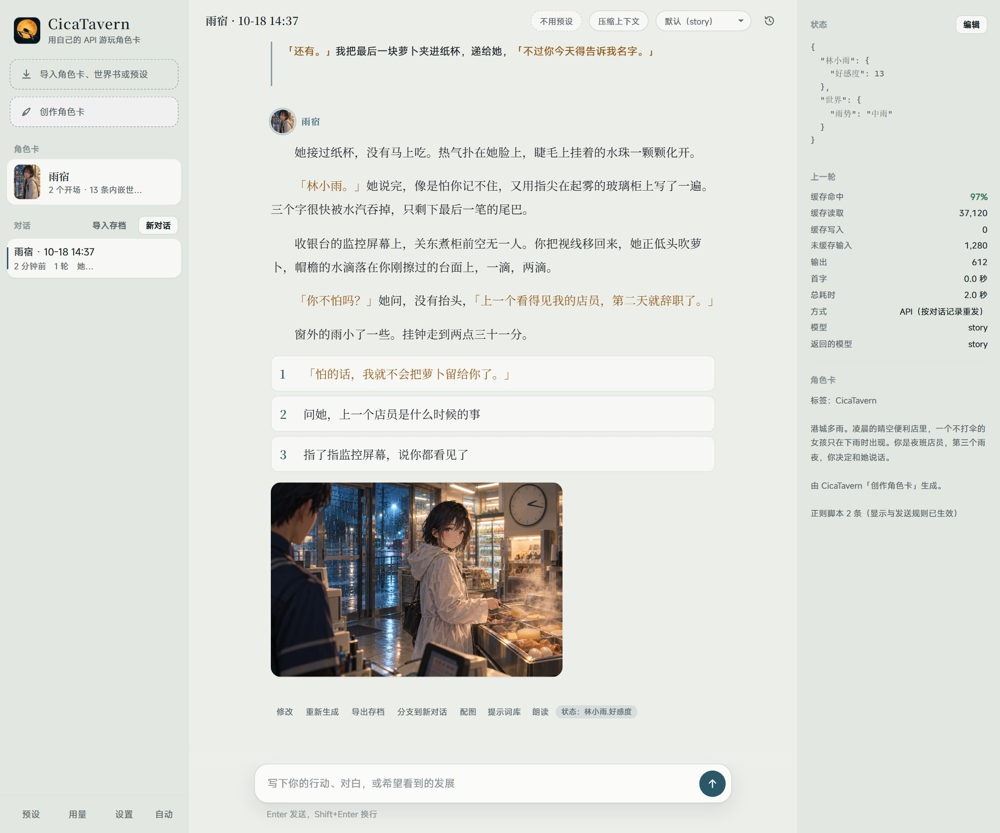
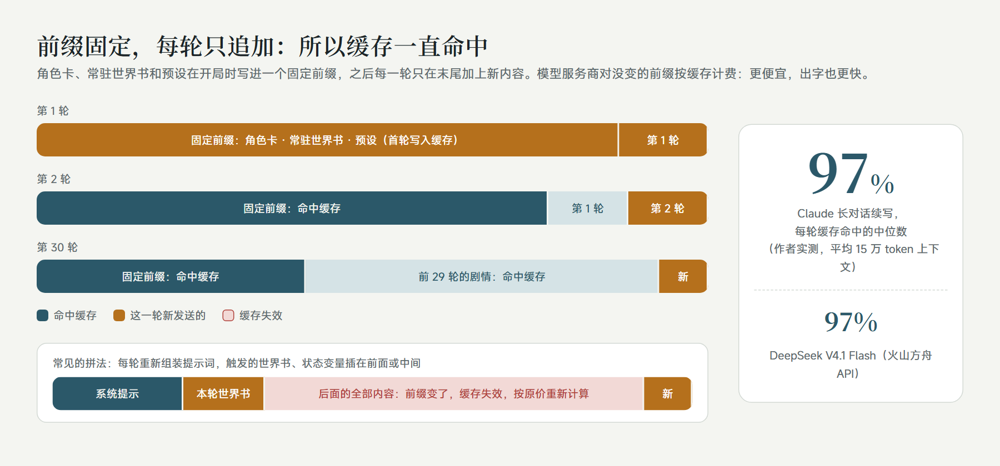
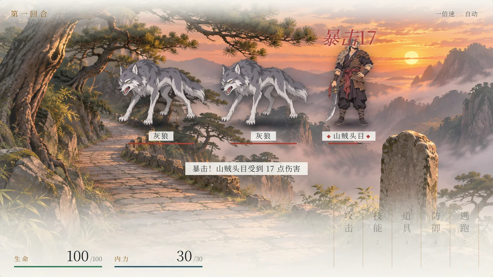
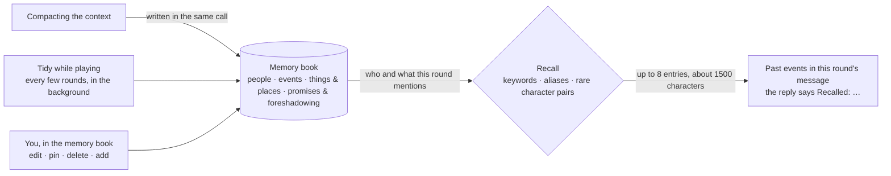
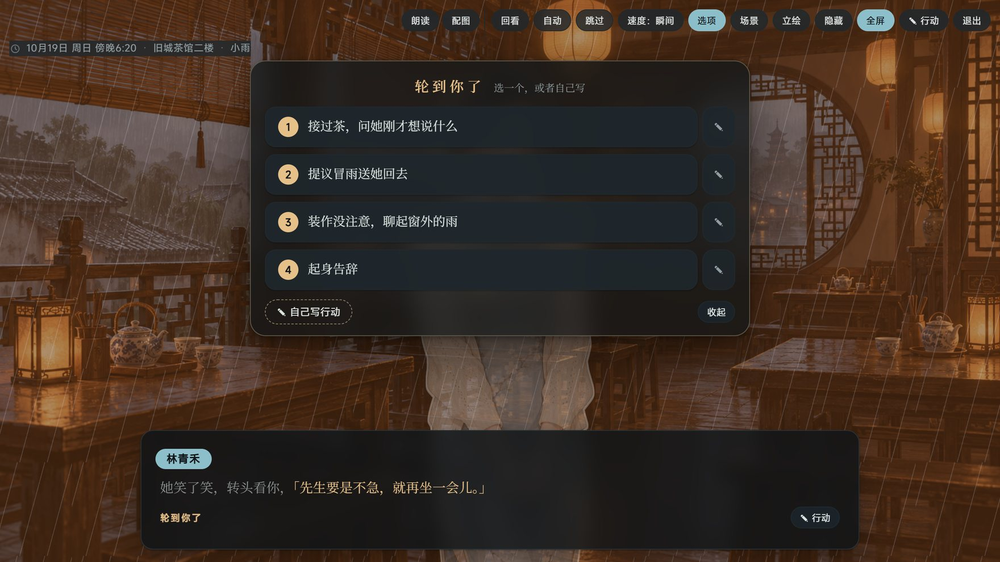
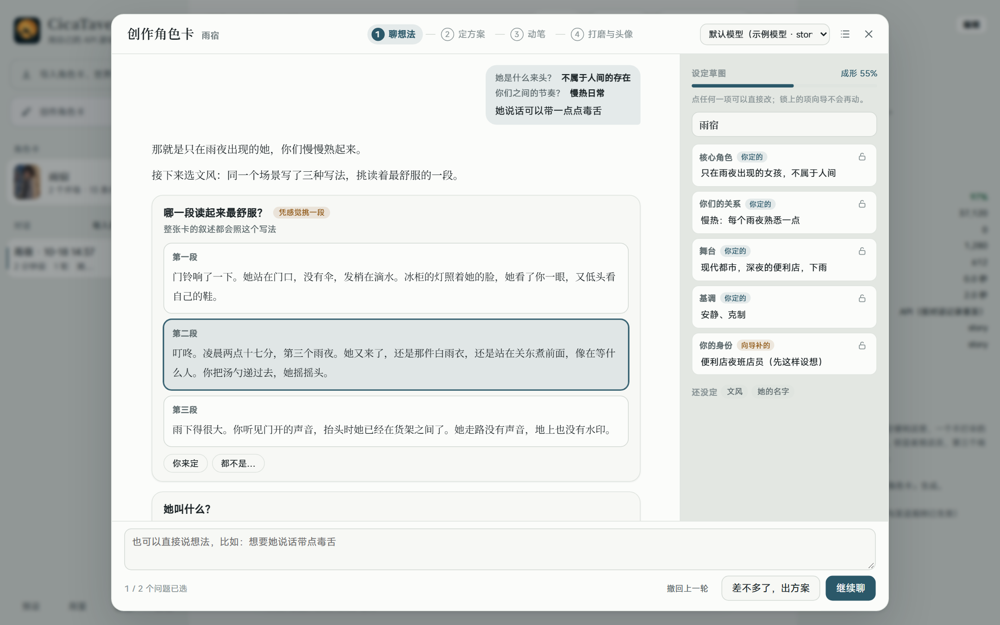
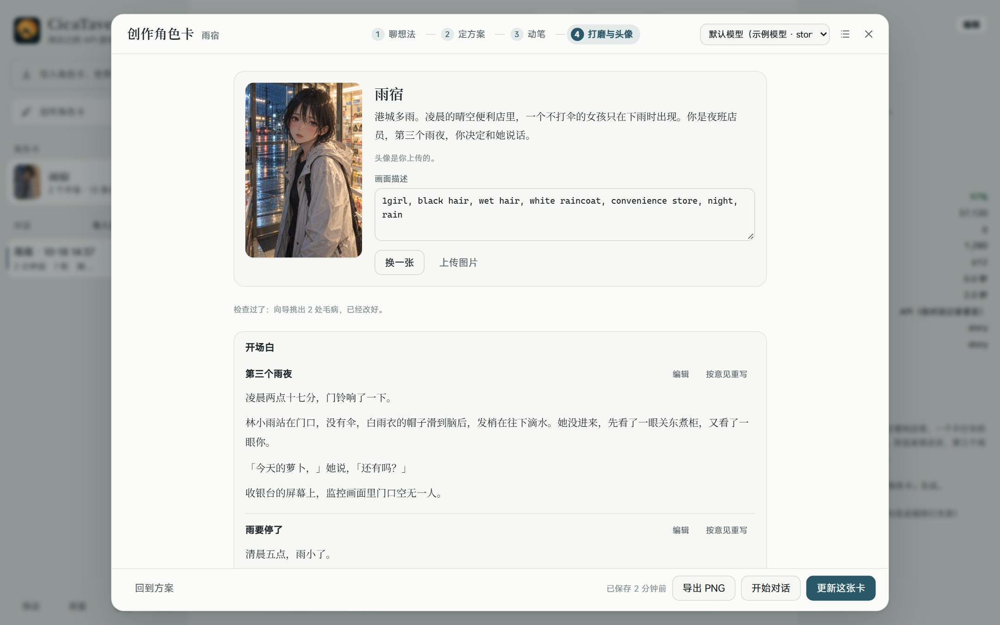
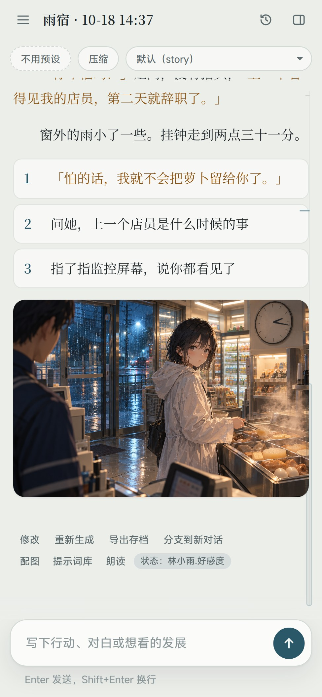
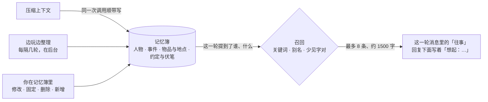

<p align="center"></p>

<details>
<summary><b>English</b> · click to read this page in English</summary>

# CicaTavern

**An agent-style player for SillyTavern character cards.** Import the character cards, world books and presets you already use, and play them with **your own model API** (DeepSeek, OpenRouter, Anthropic, OpenAI, Gemini, Gemini Agent Platform (formerly Vertex AI), Kimi, Zhipu, Qwen, Volcano Engine Ark, a local Ollama, and more):

- **High cache hit rates**: prompts are built around the provider's cache, so in a long story most of every turn is billed at the much cheaper cached rate, and replies start faster.
- **Long-term memory**: what the context compacted away is kept in a memory book and recalled when the story brings it up again, without breaking the cache or needing any extra API.
- **SillyTavern-compatible**: character cards, world books, presets, regex scripts, MVU variables and the status-bar UIs inside cards work as imported.
- **Pictures and read-aloud built in**: illustrate a scene with one click; dialogue and narration each get their own voice, and you can tap a line of dialogue to hear it.
- **Visual novel mode**: turn the story into a game screen with one switch — scene backgrounds, the speaker's sprite, a name plate, one line at a time, and the choices in the middle of the picture.
- **Characters keep their look**: every character's face, outfit, reference picture and voice are kept, so they stay the same person however many pictures you make.
- **A guided card creator**: not sure what you want yet? The creator asks you step by step and writes a complete card at the end.

Unzip and run on Windows; there is an Android app too. Everything stays on your own device.

> The interface comes in English and Simplified Chinese (since 1.5.0). It follows your system language; to switch, open Settings → More → 界面语言 · Interface language. Menu names below are given in Chinese with an English gloss, which may be worded a little differently from the English interface.

<p align="center"></p>
<p align="center"><sub>Example screenshot: this card was made with the card creator, and the illustration was drawn from the story by an image API.</sub></p>

## Why CicaTavern

### Agent-style: more than a chat box

The model takes care of several jobs in the background while you play:

- **Generation runs in the background**: switch to another chat or reload the page, and the turn still finishes.
- **Models share the work**: for a picture, a helper model reads the scene and writes the image prompt from the character roster; "compress context" (压缩上下文) has the model write the story so far into a save (characters, events, foreshadowing, style) and carry on in a clean context; the card creator plans, drafts, reviews and revises.
- **State updates itself**: variable updates at the end of a reply (MVU format) are parsed and shown in a status bar under the latest reply (numbers as bars, with this turn's change); you can also edit them by hand in the right panel.

### High cache hit rates: long stories stay cheap and fast

<p align="center"></p>

The card, the always-on world book entries and the preset go into a fixed prefix when a chat starts; after that, each turn only appends to the end. Everything that changes (triggered world book entries, state variables, the per-turn reminder) goes last, so the cached part in front is never touched. The Anthropic API gets cache breakpoints automatically; DeepSeek, OpenAI and similar APIs cache an identical prefix on their own.

From the author's own long chats (October 2026):

| Model | Average context | Turns counted | Cache hit per turn (median) |
|---|---|---|---|
| Claude Opus 5.5 | about 150k tokens | 84 | 97% |
| Claude Sonnet 5.5 | about 60k tokens | 51 | 93% |
| DeepSeek V4.1 Flash (Volcano Engine Ark API) | about 70k tokens | 13 | 97% |

<sub>The two Claude rows come from the author's personal build, which sends the same prompt structure through Claude Code; with the Anthropic API, CicaTavern sets cache breakpoints the same way. Real hit rates also depend on the provider: some third-party relays count caching differently and hit less. Every turn's cache hit and cost are shown in the right panel and in the usage panel (用量).</sub>

### Long-term memory (Beta): what was compacted comes back when it matters

<p align="center"></p>

A long story has to compact its context sooner or later: the story so far becomes a story archive, and after a few rounds of that the oldest details blur. A promise made long ago, a side character's name, where some object came from: the model no longer knows. Long-term memory writes those details down as separate entries and puts them back in front of the model when the story brings them up again.



- **Writing it costs next to nothing**: the entries are written by the same call that writes the story archive, so the input is still read from the cache and only a thousand or two output tokens are added; when they don't come, they are asked for once on their own, and failing that the compaction still goes ahead. They are plain lines, not JSON, so cheap models write them reliably.
- **The cache stays intact**: recalled entries are only appended to this round's message; the fixed prefix doesn't change by a character, so the cache keeps hitting. Only what has been compacted away is recalled: what is still in the context the model can already see.
- **No vector database, no embedding API**: entries are found by title, keyword and alias first; when the wording differs, rare pairs of Chinese characters fill in: only pairs that few entries share count, and enough of them must match. It is all plain JavaScript with no new dependencies, so it works with a single provider and on Android too.
- **A budget, not a flood**: up to 8 entries and about 1500 characters a round (adjustable); pinned entries go first, no kind takes more than half, and an entry already sent since the last compaction isn't sent again.
- **It follows branches**: the memory book is stored as snapshots on the chat tree's nodes, and the latest one on the current line is the one in effect, so regenerating, branching and rolling back return it to how it was at that point without any extra syncing.
- **You decide**: Memory in the top bar opens the book to edit, pin, delete and add entries or jump to the round they came from; entries you edited are never overwritten by the model. It exports as a SillyTavern lorebook, and Export archive carries it.
- **Variables keep the numbers**: affection, money and item counts stay with MVU variables; memory keeps what happened and who was there.

Turn it on in Settings → Model → Long-term memory (Beta); it is off by default. Tidy while playing can use the helper model (only the latest rounds, cheaper) or the chat model (the whole story in view, more accurate).

### Works with SillyTavern cards, world books and presets

- **Character cards**: SillyTavern V1/V2/V3 PNG and JSON, with embedded world books, regex scripts and alternate greetings. A new version of a card can replace the old one in place, keeping your chats.
- **World books**: always-on and keyword entries, with regex keys, secondary keys, probability and insertion position. Standalone world books can be attached to a card, and after import every entry can be searched, switched on or off and edited under View entries (查看条目).
- **Regex**: the regex scripts in cards and presets work as they are. Settings → Writing → Regex also holds global scripts and regex sets: a set works only on the cards you put it on, after the card's own scripts. Each script has a test box, and a whole group or the scripts you select can be exported as SillyTavern regex files, copied, moved or switched on and off together.
- **Presets**: a light built-in "Basic preset" with switches for point of view, style, not acting for you, limited knowledge, dark themes, intimacy, choices (tap to send) and a time box, so it plays well without importing anything. You can also import Chat Completion presets, toggle and edit their entries, and pin the ones you use most as quick switches.
- **MVU variables and status bars**: `[InitVar]`, `<UpdateVariable>` / JSONPatch and the older `_.set()` are supported; EJS templates run in a QuickJS sandbox (with ST-Prompt-Template's `getwi`, `matchChatMessages` and the like). HTML UIs inside cards render in isolated iframes, with a compatibility layer for the common Tavern Helper (酒馆助手) functions: variables, lorebooks (changes kept for that chat only), calling the model (each card asks first) and sending messages. The libraries those UIs need, such as jQuery and Vue, load from jsDelivr, so some may be missing offline.
- **SillyTavern chats**: import a .jsonl (drop it into the window or use Import archive) with every turn, every swipe and the MVU variables; a long one can be compacted into a story archive first.
- **Web search**: the globe left of the input box turns it on per chat. It uses the provider's own search, like SillyTavern's "Enable web search": Claude on the Anthropic interface, the OpenAI Responses interface and OpenRouter models have it. When real-world facts are needed the model searches first and then writes; what it searched for and the pages it cited are listed under the reply. Searches cost extra.
- **Blocked words**: Settings → Writing → Blocked words removes words, masks them with `*` or swaps them for words you choose, both in what the model is sent (card, preset, lorebooks, history and your messages) and in the replies shown; each word can be switched on or off and kept to one side. Only the copy being sent or shown changes, so switching a word off brings it back; Chinese has no spaces between words, so longer words to leave alone go under Exceptions. After a change, chats that use the word write the cache again from where it appears, and saving tells you from which turn.
- **Personas and styles**: Settings → Writing keeps your personas and writing styles as lists you can add to, copy, import and export. Personas move to and from SillyTavern's Persona Management (restore the exported file there, or import its backup here); a style exports as a SillyTavern system prompt, and a plain text file of rules imports as one. Each card can pick its own persona and style, otherwise it uses the defaults; a chat keeps the ones it started with until you click "Use in this chat", and the next turn writes the cache once more. Exported cards never carry your persona.
- **Versions and branches**: regenerate, swipe between versions, branch from any message, roll back, edit any message; a whole chat can be packed up and moved to another device. A round the model's content check keeps stopping can be hidden: it stays in the chat but is no longer sent.

### Pictures and read-aloud

- **Pictures**: one click, and a helper model writes the image prompt from the scene, the characters' looks and the card's art style; you can review it before drawing. Backends: an OpenAI-compatible image API (gpt-image and others), Gemini's own image models, NovelAI, or a local ComfyUI workflow or SD WebUI / Forge. New replies can be illustrated automatically. Prompts you have drawn are kept in a prompt library.
- **Read-aloud**: quoted dialogue uses the dialogue voice and everything else the narrator voice; tap a quoted line in the story to hear just that line. Voices can come from cloud services such as Fish Audio, MiniMax, Gemini or any OpenAI-compatible speech API, the browser (free), or a TTS model on your computer or local network; everyone in the cast can have a voice of their own. Audio is cached once read. New replies can be read automatically.
- **Voice input**: speak into the microphone beside the input box and the words go into the box for you to read before sending. A provider's transcription API (SiliconFlow's SenseVoice is free), whisper on your own computer, or the browser's built-in recognition turns them into text.

### Visual novel mode

<p align="center"></p>
<p align="center"> </p>

- **One switch**: turn on Visual novel in the top bar and the latest reply plays like a game; remembered per card. What the model is sent never changes, so the cache is untouched.
- **Sprites**: whoever speaks steps forward and steps back during narration. White-background reference pictures in the roster are cut out and outlined; anyone without one gets a half-body sprite drawn from their looks.
- **Scenes**: when the story reaches a new place, an empty scene is drawn as the background and reused whenever the story returns; time of day and weather are tints and rain or snow over it.
- **Speakers and dialogue**: who speaks is told even from "she said" or a nameless innkeeper; each name plate has its own colour, and dialogue is coloured apart from narration.
- **Plays like a game**: the choices open in the middle of the picture and number keys pick them; backlog, auto, skip, full screen and line-by-line reading are all there, and the ▾ beside Read and Pictures changes voices, models and drawing without leaving.
- **CG gallery**: every picture on the storyline in one place, each marked with its turn, to browse full size.

### Characters keep their look

- **Character roster**: each character's fixed face, everyday outfit, a reference picture and a LoRA. When several characters share a picture, each is described separately, so faces don't blend.
- **Each card's own art style and negative prompt**, added to every picture for that card.
- **Redraws keep the earlier pictures**: when a picture, reference image, sprite or expression, scene or avatar is redrawn or replaced, each keeps its last few (5 by default; set in Pictures & voice → Image backend) in a row beneath it: click one to bring it back, delete the ones you don't want.
- **Each card's own dialogue and narrator voices**.
- Cards made with the card creator get their roster built automatically.

### Guided card creator

<p align="center"></p>

If you can't quite say what you want, the creator guides you round by round:

1. **Talk it through**: each round it says how it understands your idea, then asks the two or three questions that matter most. Every option comes with a line the character might say, so you can pick by feel; the writing style is chosen from short samples. The sketch beside it updates with your choices; you can edit or lock any part.
2. **Settle the plan**: characters, setting, style, status bar, greetings and world book entries at a glance. Anything the creator filled in for you is listed separately; write a sentence wherever you want a change. Which values the status bar tracks, how they show and how they change can be edited directly, with a live preview; the finished card has the same status bar in SillyTavern.
3. **Write**: the full world book and greetings are written in a few steps from the plan, then checked for clichés and contradictions and fixed.
4. **Polish and portrait**: edit any part directly, or write a note and let the creator rewrite it. The portrait is drawn by your image backend from the character's looks, or you can upload one. Save to start playing, or export a PNG that SillyTavern imports directly.

<p align="center"></p>

### On your computer and your phone



- On the same Wi-Fi or over Tailscale, open the passcode link in your phone's browser and play with the models and data on your computer.
- Or install the Android app, which runs on the phone by itself, no computer needed.
- On iPhone (Safari) or Android (Chrome), add the link to the home screen: it opens full screen like an app, no passcode to type again.
- The interface is laid out for phone screens, and the settings windows are grouped menus.

<br clear="right">

## Latest changes [2.4.0]

- **2.4.0: direct chat**: talk to a model with no character card, from the top of the left column, with text files, web search and replies shown as Markdown.
- **2.4.0: game rules (in development)**: a card's ⋯ menu has Game rules, on per card and off by default. It brings checks and dice, a pack, turn-based fights, levels and achievements, with success worked out by the program.
- **2.4.0: check a card, trial run**: the program finds format problems and a model suggests changes, each one taken or undone by itself; a model can also play the card for a few rounds and report. The card creator gained reference files, gameplay blocks and card sizes.
- **2.4.0: smoother to use**: delete a single message, a QR code for phone access, search in settings, side columns that fold away, a story column you can drag wider, rewritten writing styles. Going up after a jump no longer throws you to the end of a passage.
- **2.3.2: the story stays put**: in 2.3.1, switching chats or finishing a new turn could leave you a few rounds above the latest one; you now land at the very bottom, and swiping or editing a message keeps you on the same line. The app opens on the chat you last played.
- **2.3.2: native Gemini, MOSS voices, exports on Android**: providers can use Gemini's native API (generateContent), and the Gemini API template starts on it; MOSS joins the voice sources; the Android app exports chat packages and card PNGs. Errors tell a busy model, a rate limit and a used-up quota apart, and visual novel mode shows how a reply's picture is coming along.
- **2.3.1: long chats stay smooth**: in a chat of two or three hundred rounds, messages out of view are no longer laid out, so a reply streaming in costs next to nothing to show, and long chats open several times faster. The rail beside the story spreads out only the ten or so rounds you are reading and folds the rest into a band at each end, unfolding as you scroll.
- **2.3.1: card interfaces run more SillyTavern commands**: dozens of them, like /setvar, /if, /while, /sys, /cut, /gen and /buttons, with pipes and closures; a command this app lacks skips that step and the rest runs. Also fixed: the delete button of a chat not showing on phones, a Base URL with spaces inside not connecting, opening screens failing on /sys, and the whole chat flashing after a card interface saved its variables.
- **Long-term memory (Beta)**: Settings → Model → Long-term memory (Beta), off by default. When the context is compacted, the same call that writes the story archive also notes the people, events, things and places, and promises and foreshadowing as separate entries in the chat's memory book; when a later round mentions them (by a keyword, an alias or similar wording), the matching entries go along with that round's message, and the reply says Recalled: …. They ride in that round's message only, so the frozen prefix stays as it is and the cache keeps hitting. Memory in the top bar reads, edits, pins, deletes and exports them as a world book, and Tidy while playing can note things down in the background every few rounds. The memory book follows branches, and Export archive carries it.
- **Hide this round**: replies have Hide this round: the round stays in the chat, faded, but is no longer sent to the model, and you can unhide it any time. When one round keeps a content check refusing everything after it, hide it and play on; the latest round can be hidden too.
- **Changing a card by talking, more dependable**: when the model says it made changes but wrote none out, it is asked once more; still nothing, and you are told why and can ask again. Asked to make a card an MVU card, it sets up the initial variables and the update rules, and a chat under way gets the variables when you apply the change to it.
- **Fixes**: the error some cards' opening screens showed (Cannot read properties of undefined (reading '…')).
- **Now licensed under the AGPL-3.0**: from this version on; see License below. Using it yourself is not affected.
- **macOS test build (beta)**: the Mac app is signed with an Apple Developer ID and notarized; the release page has only dmg installers for the Mac (Apple silicon and Intel), which the in-app update uses too.

2.2 added pinned, favorited and reordered cards and groups, dragging cards out to export them, picture prompts written your way with art style presets, Gemini Agent Platform, the model's thinking shown, phone and computer kept in step, and copying messages and picking several choices; 2.1 added grouped card creation settings, background writing and a values preview, making a card a visual novel with its own preset, and New choices; 2.0 added voice input, a drawing history, regex sets and personas chosen per card, the context usage bar, ComfyUI simple mode and clearing old versions after an update; 1.9 added web search, blocked words, card UIs that call the model and edit lorebooks, an error log, the visual novel HUD and speaker marks, and an update mirror in China; visual novel mode came in 1.8. Download from [Releases](https://github.com/Shikasar7/CicaTavern/releases/latest); 1.4.0 and later can update in the app. Everything that changed is in [CHANGELOG.md](CHANGELOG.md).

## Getting started (Windows)

1. Unzip anywhere (paths with Chinese characters are fine).
2. Double-click **CicaTavern.exe**. It starts the server in the background and opens an app window (Edge or Chrome, without an address bar). The first time, it lists what it connects to (see [Privacy](#privacy)). For a desktop icon: 设置 (Settings) → 更多 (More) → 桌面快捷方式 (Desktop shortcut).
3. First use: at the bottom of the model picker in the top bar, choose 管理模型供应商… (Manage providers) → 添加 (Add) → 从模板开始 (Start from a template), pick a provider, paste your API key, and click 从接口获取模型列表 (Fetch model list) to check the connection. Then choose a default model in 设置 (Settings). Google has two templates: "Gemini API" takes an AI Studio key; "Gemini Agent Platform" (Google Cloud, formerly Vertex AI; a new account's free-trial credit works there) takes an Agent Platform API key, with PROJECT_ID in the address replaced by your project ID, or, where an organization allows no API keys, a JSON credential (a service account's JSON key, or the file gcloud's login writes), picked with 选择 JSON 凭据文件 (Choose a JSON credential file). The template note says how.
4. Top left, 导入角色卡、世界书或预设 (Import card, world book or preset): choose a SillyTavern PNG or JSON card, then 新对话 (New chat).

The Node runtime comes with it (`runtime/node.exe`); nothing else needs installing. About a minute after every page is closed, the background server exits by itself; 设置 → 更多 → 退出应用并停止后台服务 (Quit and stop the background server) stops it at once.

**CicaTavern.exe is not code-signed.** Windows may say "Windows protected your PC" the first time: click **More info → Run anyway**. It won't ask again, and versions downloaded by the in-app updater don't ask either (see [Code signing](#code-signing)). CicaTavern.exe is a very small program (source in `launcher/`) that does two things: runs `runtime\node.exe bin\launch.mjs` without a console window, and creates the desktop shortcut through Windows' own interface. `runtime\node.exe` is the official, signed Node.js. There are no script launchers in the package. To see the server's output, start it with 排查问题（带控制台）.cmd (troubleshooting, with a console).

## Updates

设置 (Settings) → 更多 (More) → 更新 (Update): when CicaTavern opens, it checks GitHub at most once a day for a new version and shows "有新版本 x.y.z" (new version available) with the release notes here. Automatic checks can be turned off; 检查更新 (Check for updates) works any time. When GitHub can't be reached or hasn't answered within a few seconds (common in mainland China), it asks the mirror at [cnb.cool](https://cnb.cool/cicatavern/CicaTavern/-/releases) instead: the same files under the same version, and the release information there is used only with the publisher's Ed25519 signature. The package can come from GitHub or the mirror; both are checked against the same SHA-256.

1. 下载更新 (Download update): downloads the Windows package and checks it against the SHA-256 published with the release, throwing it away on a mismatch. It is unpacked next to the current folder (for example `CicaTavern-1.5.0-win-x64` beside `CicaTavern-1.4.0-win-x64`). The download uses your proxy setting.
2. 重启并更新 (Restart and update): the server restarts on the new version and the page reloads. Only once the new version is up are the desktop and Start-menu shortcuts pointed at the new folder; the old folder's CicaTavern.exe also forwards to the new version. If the new version fails to start, the old one comes back and nothing changes.
3. The old version's folder stays: 回到上一版 (Back to the previous version) switches back; once you're happy with the new version, delete it under 旧版本文件夹 (Old version folders).

Your data lives in `%USERPROFILE%\.cicatavern\`, outside the program folder, so updating, switching back or deleting old versions never touches it. The updater only downloads the zip from this project's GitHub Releases (or their copy on the mirror in China) and unpacks it itself; it never runs a downloaded installer and uses no PowerShell or scripts. You can still update by hand: unzip the new version into a new folder, double-click its CicaTavern.exe, and add the desktop icon again under 设置 → 更多 → 桌面快捷方式.

## Proxy

If you need a proxy for overseas APIs (OpenRouter, Anthropic, OpenAI, Gemini and so on), choose one under 设置 (Settings) → 连接 (Connection) → 网络代理 (Network proxy):

- **不用代理** (No proxy, the default)
- **跟随系统代理** (Follow the system proxy): reads Windows' proxy setting, which is what tools like Clash or v2rayN set in "system proxy" mode. It is re-read every minute, so switching your proxy tool on or off needs no restart.
- **指定代理地址** (A proxy address): for example `http://127.0.0.1:7890`. HTTP proxies only, not SOCKS (most proxy tools' mixed port accepts both).

Providers set to 直连 (direct) skip the proxy: DeepSeek, Kimi, Zhipu, Qwen, Volcano Engine Ark and the other mainland China services in the templates are direct by default.

## Pictures

Pick a backend under 配图与朗读 (Pictures and voice) → 画图方式 (How to draw):

- **OpenAI-compatible image API**: choose a provider you've added and its image model (gpt-image, grok, SiliconFlow and others); the portrait or a reference picture can be used as a reference. With OpenRouter as the provider, its image models (`google/gemini-…-image` and others) are used.
- **Gemini's own image models** (Nano Banana): choose a provider made from one of Google's templates (Gemini API or Gemini Agent Platform); the model defaults to `gemini-2.5-flash-image`, or try `gemini-3-pro-image-preview`. Reference pictures of cast members in the frame are sent along, so faces stay the same.
- **ComfyUI**: import a workflow saved with "Export (API)", with placeholders marking the prompt, size and so on: write the positive prompt as `%prompt%`, as in SillyTavern, whose ComfyUI workflows import as they are. `examples/comfy-illustrious-api.json` is a text-to-image example; change the model name to your own.
- **NovelAI**: enter a persistent token. V4.5 / V5 and character references are supported; the best choice for anime.
- **SD WebUI / Forge**: AUTOMATIC1111, Forge or reForge on your computer (started with `--api`), drawing with the model loaded there; sampler, steps, CFG and negative prompt can be set, and a cast member's or the card's LoRA goes into the prompt as `<lora:…>`.

While the image backend isn't set up (no provider, no token), its row in Pictures and voice stands out.

The helper model that writes image prompts is chosen here too. With a card selected, the same window sets that card's art style, negative prompt and character roster.

## Read-aloud

In 配图与朗读 (Pictures and voice), choose each card's 对白音色 (dialogue voice) and 旁白音色 (narrator voice): quoted dialogue uses the dialogue voice and the rest the narrator voice (no narrator voice means narration isn't read). Everyone in the card's cast can also have a voice of their own: visual novel mode reads each line in its speaker's voice, and so do Read aloud and tapping a line in the chat, with the dialogue voice for anyone without one. Tap a line of dialogue to hear just that line. Voices come from three kinds of source, all set under 配图与朗读 → 朗读来源 (Voice sources), each with a 试听 (preview) button that works before saving:

**Cloud services** (need a key, billed per character, on your own account)

- **A provider's speech API**: choose a provider you've added and enter the model and voice. It uses the provider's OpenAI-compatible `/audio/speech`, with the provider's address, key and proxy setting. OpenAI: `gpt-4o-mini-tts` (adjusts the delivery to the emotion in the reply). SiliconFlow: `FunAudioLLM/CosyVoice2-0.5B`; leave the voice box empty to list its preset voices. Local OpenAI-compatible wrappers such as Kokoro or GPT-SoVITS go here too; they run locally and cost nothing.
- **Fish Audio**: enter your API key (saved when you leave the box or press Enter) and paste the links of voices you like (`fish.audio/m/…`) into the voice box, optionally followed by a space and a name; for voices you cloned yourself, click 从账户读取音色 (Read voices from account). Emotions in the reply are passed as tone tags before the line.
- **MiniMax**: enter your API key and choose the mainland or international site (a key only works on the site that issued it). Leave the voice box empty for the system voices; for cloned or designed voices, click 从账户读取音色 or enter a voice_id.
- **Gemini speech**: choose a provider made from one of Google's templates (Gemini API or Gemini Agent Platform) (it shares the key and proxy with chat); the model defaults to `gemini-2.5-flash-preview-tts`. Leave the voice box empty to list Google's 30 prebuilt voices (Kore, Leda, Puck, Charon…), which read Chinese too; emotions in the reply become a spoken-style prompt before the line.

**Browser** (built into the device, free, works out of the box)

- The voices depend on the browser and system. Browser voices belong to each device: where a device doesn't have the same voice, its default Chinese voice is used.

**Local voice bridge** (a TTS model on your computer or local network, nothing goes to the cloud)

- Enter its bridge address. The service needs `POST /api/tts` (`{ "text", "voice" }` → audio) and `GET /api/persona/list` (`{ "voices": [{ "name" }] }`).
- On a phone, paste the whole link from the computer's CicaTavern (设置 → 手机访问, Phone access) to use the voices set up there (the cloud keys stay on the computer).

Fish and MiniMax keys are kept in the data folder's `voice-keys.json`; the page only ever sees the last four characters. Audio is cached in the data folder's `media/tts/` and made again when you change the voice or model; if a line sounds wrong, click 重新合成 (Synthesize again) on the progress bar. When a card has no dialogue voice and a local voice bridge is set, the bridge's current voice reads.

## Voice input

The microphone right of the input box: click it and speak, then click it again (or click 完成, Done) when you finish. What you said goes into the input box at the cursor for you to read and edit; it is never sent by itself. While recording, the strip above the input box shows the time and 取消 (Cancel); Esc cancels too, and clicking the microphone while it transcribes cancels that. A recording is at most 3 minutes, and one in which nothing was heard isn't sent.

The first click opens 配图与朗读 → 语音输入 (Pictures and voice → Voice input) to pick who turns recordings into text (the 语音输入 row under 配图与朗读 in 设置, Settings, opens it too). Nothing is recorded before you pick. The first two need nothing installed and work as soon as they're picked; the whisper server is for people who already run one, and CicaTavern never downloads a model for you.

- **A provider's transcription API**: choose a provider you've added; it uses the provider's OpenAI-compatible `/audio/transcriptions`, with the provider's address, key and proxy setting. With no model, one is picked by provider: SiliconFlow `FunAudioLLM/SenseVoiceSmall` (free, reachable from mainland China), Groq `whisper-large-v3-turbo` (fast and cheap), OpenAI `gpt-4o-mini-transcribe`, anything else `whisper-1`. Providers with only a chat API, such as DeepSeek or Anthropic, can't transcribe.
- **The browser's built-in speech recognition**: in Edge, Chrome and Safari; free, nothing to set up, and the words appear as you speak. Recordings don't pass through CicaTavern: the browser sends them to its own recognition service (see [Privacy](#privacy)). The Android app, Firefox and a phone browser opened through an http link don't have it: pick a provider on the same page too, and those places use it instead.
- **A whisper server you run yourself** (this machine or the LAN): no key, and recordings never leave your network. For an OpenAI-compatible server ([speaches](https://github.com/speaches-ai/speaches), LocalAI…) give the address up to `/v1`, such as `http://127.0.0.1:8000/v1`; speaches also needs a model (such as `Systran/faster-whisper-small`). For [whisper.cpp](https://github.com/ggml-org/whisper.cpp)'s server, give it up to `/inference`. On a phone, use the computer's LAN address.
- **Off**: no microphone button.

Picking the spoken language makes transcription more accurate and faster; when detecting, whisper sometimes writes Chinese in traditional characters, and with 中文 (Chinese) picked it is asked for simplified. Each choice has a 试一试 (Try it) button that works before saving. The names of the characters and your own in the chat go along with each recording, so names come out spelled right.

When a phone browser opens CicaTavern through a plain http LAN link, the browser won't let the page use the microphone (that needs https or this machine's own address), so the microphone button uses the phone's own recorder instead: confirm when you've recorded, and it is turned into text. In the Android app, the first click asks whether the app may record audio.

## Phone access

Set 设置 → 连接 → 手机访问 (Phone access) to 同一 WiFi 或 Tailscale (Same Wi-Fi or Tailscale) and restart the server; a link with a passcode then appears in the settings. Open it in your phone's browser.

- Only this computer's own addresses are accepted, so other web pages can't call the API.
- **Don't forward the port to the internet**: anyone with the link can spend your model credit. Use Tailscale when you're out.
- If the phone can't connect, Windows has probably marked the Wi-Fi as a public network, or the firewall is blocking Node.js: make it a private network and allow inbound connections to this port from the local network only.

## Android

Play on your phone without the computer: download `CicaTavern-<version>-android-arm64.apk` from the Releases page, allow "install unknown apps" on the phone, and install it. It needs a 64-bit phone with Android 10 or later (nearly every phone from the last few years).

- The app runs on the phone by itself, with the same interface and features as on the computer; providers and API keys have to be entered on the phone again.
- The phone and the computer keep separate data. To move a chat, use 导出存档 (Export save) on one side and import it on the other, or click a chat's ⇩ in the chat list on the computer (it packs the whole chat) and import that with 导入存档 on the phone.
- For read-aloud, use a cloud service: there are usually no browser voices in the app.
- Voice input: there is no browser recognition in the app, so use a provider's transcription API (with browser recognition picked, the provider picked with it under Voice input is used instead) or a whisper server on your computer. The first time you click the microphone, Android asks whether the app may record audio; if you refused, turn the microphone on under the phone's Settings → Apps → CicaTavern → Permissions.
- Updates: 设置 → 更多 → 更新 shows the new version and its notes; 下载并安装 (Download and install) downloads it in the app, checks it against the SHA-256 and signature on the release page, and opens the system installer to install over the old version; all data is kept. The first update asks you to allow CicaTavern to "install unknown apps".
- How to build it and more: [android/README.md](android/README.md).

## Data

Everything is in `%USERPROFILE%\.cicatavern\`: cards, world books, presets, chats, pictures and `providers.json` (with your API keys, in plain text). To move to another computer, copy the whole folder. Start with `--data <folder>` to keep it somewhere else (on a USB stick for a portable setup, for example):

```
runtime\node.exe bin\start.mjs --data D:\TavernData --open
```

The background server's log is `%USERPROFILE%\.cicatavern\logs\server.log`.

## Privacy

CicaTavern collects no usage data and sends nothing to the developer. Your data stays on your own device. So does the error log: the developer only sees it if you copy or save it and send it yourself.

What it connects to:

- **Services you add yourself**: model providers (with web search on, they also run the searches), image backends (OpenAI-compatible APIs, Gemini, NovelAI, ComfyUI, SD WebUI), voice services (Fish Audio, MiniMax, Gemini and others) and voice input transcription. They are contacted only after you set them up, and what goes to them is your chat content and the related settings; how each one handles data is covered by its own privacy policy.
- **Voice input**: nothing is recorded until you click the microphone. The recording, with the character names in the chat, goes to the one you picked under 语音输入 (Voice input) to be turned into text: a provider's transcription API, or your own whisper server (the recording stays in your network). With the browser's built-in speech recognition, the recording doesn't pass through CicaTavern: the browser sends it straight to its own recognition service. Chrome sends it to Google, Edge to Microsoft, Safari to Apple. CicaTavern doesn't keep recordings.
- **Connections made without being configured.** They are listed at the first start, where each can be switched off; later, change them under 设置 → 更多 → 隐私与网络 (Privacy and network) and 更新 (Update). Nothing on this list happens before you confirm:
  - Update check: GitHub (api.github.com) at most once a day, and the mirror in mainland China, cnb.cool (Tencent), when GitHub hasn't answered within a few seconds. Only the version number is sent; they can see your IP address. The Android app does the same.
  - Body font: the Noto Serif SC font from Google Fonts.
  - Tavern Helper libraries: jQuery, Vue, Tailwind and similar libraries from public CDNs such as jsDelivr, loaded when a card's Tavern Helper UI uses them.
- **Web content inside cards and presets** may load pictures or fonts from addresses the card's author wrote into it. When a card's UI wants to call the model, each card asks you first; once you agree, its requests go to the model provider of that chat. When a card's UI has its own API settings and the browser can't reach the address you entered, you're asked whether CicaTavern should connect for it instead (once per card and address); once you agree, what it sends goes to that address through CicaTavern. These answers are kept on your device; change them under Card UI permissions… in the card's menu.

## Uninstall

1. 设置 → 更多 → 退出应用并停止后台服务 (Quit and stop the background server), or close every window and wait a minute.
2. Delete the program folder (`CicaTavern-<version>-win-x64`; if you've used the in-app updater, older version folders may sit next to it) and the CicaTavern shortcut on the desktop or in the Start menu.
3. Your data is in `%USERPROFILE%\.cicatavern\`; delete it too if you don't want it any more. CicaTavern writes nothing to the registry, installs no service and doesn't start with Windows.

Android: uninstall the app in the system settings; its data goes with it.

## Code signing

CicaTavern.exe is not code-signed at the moment. The Windows package, including CicaTavern.exe, is built automatically from this repository's source by GitHub Actions (`.github/workflows/windows-release.yml`; the build logs are on the Actions page). Every release page lists the zip's SHA-256, which the in-app updater checks too; use it to verify a package you downloaded by hand.

The Android APK is signed locally by the author with their own key; the certificate fingerprint is on every release page.

## Troubleshooting

- **Nothing happens on double-click, or it says it couldn't start**: CicaTavern.exe shows the reason in a message box. You can also read the log above, or run 排查问题（带控制台）.cmd and look at the errors in the console window.
- **It says runtime\node.exe is missing**: your antivirus has probably quarantined it. Restore it from quarantine, or unzip the package again.
- **The update check can't reach GitHub**: it switches to the mirror at cnb.cool by itself; if that can't be reached either, set a proxy under 网络代理 (Network proxy), or download from the Releases page by hand.
- **Port 8790 is in use**: one is probably already running; open http://127.0.0.1:8790/ directly.
- **Overseas APIs don't connect**: check that the 网络代理 row shows your proxy under "现在走 …" (currently using).
- **Replies are cut off**: set the maximum output tokens (最大输出 token) in the provider's 高级 (Advanced) section.
- **Anything else**: open Settings → More → Error log, copy or save it, and send it to the developer with a description of the problem (a GitHub issue or the group chat). It has no chats or card contents, and keys are taken out; for a problem with what a reply says, tick "Include the open chat's last turn".

## Running from source

Needs Node 24 or later.

```
npm install
npm start          # start and open http://127.0.0.1:8790/
npm test
npm run package    # build the Windows package into dist/ (with the current node.exe; CicaTavern.exe is compiled with MSVC, which needs the Visual Studio Build Tools C++ workload)
```

## License

CicaTavern is licensed under the [GNU AGPL-3.0](LICENSE), copyright Shikasar7.

- Downloading and using it is free and unrestricted, commercial use included.
- You may modify and redistribute it, but a modified version must also be released under the AGPL-3.0 with its complete source; running a modified CicaTavern on a server for others to use also means offering them the source.
- Versions 2.2.4 and earlier were released under the MIT license, which still applies to them.
- Before contributing code, please read [CONTRIBUTING.md](CONTRIBUTING.md).

## Notes

- This project is not affiliated with Anthropic, OpenAI, Google or any other model provider. When you use their APIs, follow their terms of service and usage policies; costs are billed to your own account.
- To use Claude models, add Anthropic (an official API key) or OpenRouter as a provider. A Claude.ai subscription (Pro/Max) can't be used as an API key.
- Character cards, world books and presets belong to their original authors.
- What changed in each version: [CHANGELOG.md](CHANGELOG.md) (in Chinese).

</details>

# CicaTavern

**Agent 式的 SillyTavern 角色卡酒馆。** 导入酒馆的角色卡、世界书和预设，用**你自己的模型 API**（DeepSeek、OpenRouter、Anthropic、OpenAI、Gemini、Gemini Agent Platform（原 Vertex AI）、Kimi、智谱、通义、火山方舟、本机 Ollama 等）跑剧情：

- **缓存命中高**：提示词按缓存来设计，长对话里每轮的大部分内容都按便宜得多的缓存价计费，出字也快。
- **长期记忆**：压缩掉的旧剧情记成「记忆簿」，剧情再提到时自动想起；不破坏缓存，也不需要额外的接口。
- **兼容酒馆格式**：角色卡、世界书、预设、正则、MVU 变量、卡片里的状态栏界面，导进来就能玩。
- **自带配图和一键朗读**：一键为剧情配图；对白和旁白各用一种音色，点一句对白就能听这一句。
- **视觉小说模式**：一键把剧情变成游戏画面——场景背景、说话人的立绘、名字栏，一句一句地读，选项在画面中央弹出。
- **角色有固定的形象**：每个角色的长相、衣着、人设图和音色都记下来，画多少张都是同一个人。
- **引导式创作角色卡**：说不清想要什么也没关系，创作向导会一步步问你，最后写出一张完整的卡。

Windows 解压即用，也有安卓版；界面有简体中文和英文。数据全部存在你自己的设备上。

<p align="center"></p>
<p align="center"><sub>示例截图：这张卡是用「创作角色卡」做出来的，插图由画图接口按剧情画出。</sub></p>

## 为什么用 CicaTavern

### Agent 式：不只是一个聊天框

模型在后台替你做好几件事，你只管往下玩：

- **生成在后台进行**：切到别的对话、刷新页面，这一轮都会接着写完。
- **模型之间分工**：配图时，辅助模型读这一段剧情，按角色名册写画面提示词；点「压缩上下文」，模型把剧情写成一份存档（人物、经过、伏笔、文风），换个干净的上下文接着写；创作角色卡时，向导负责规划、动笔、审稿和修改。
- **状态自动更新**：回复末尾的变量更新（MVU 格式）会直接解析，显示在最新回复下面的状态栏里（数值是进度条，带这一轮的涨跌），右侧面板也能手动改。

### 缓存命中高：长对话也便宜、出字快

<p align="center"></p>

角色卡、常驻世界书和预设在开局时写进一个固定的前缀，之后每一轮只在末尾追加新内容。会变化的东西（触发的世界书、状态变量、本轮提醒）都放在最后，不去改动前面已经缓存的部分。Anthropic 接口会自动打缓存断点；DeepSeek、OpenAI 这类接口会自动缓存相同的前缀。

作者自己的长对话记录（2026 年 10 月）：

| 模型 | 平均上下文 | 统计轮数 | 每轮缓存命中（中位数） |
|---|---|---|---|
| Claude Opus 5.5 | 约 15 万 token | 84 | 97% |
| Claude Sonnet 5.5 | 约 6 万 token | 51 | 93% |
| DeepSeek V4.1 Flash（火山方舟 API） | 约 7 万 token | 13 | 97% |

<sub>Claude 的两行来自作者自用的版本：它通过 Claude Code 发送同样结构的提示词。CicaTavern 用 Anthropic API 时，按同样的结构打缓存断点。实际命中率还取决于供应商，一些第三方中转站计算缓存的方式不同，命中会低一些。每一轮的缓存命中和费用都能在右侧栏和「用量」面板里看到。</sub>

### 长期记忆（Beta）：压缩掉的剧情，提到时会想起来

<p align="center"></p>

长对话迟早要压缩上下文：前面的剧情压成一份剧情存档，压过几次，越早的细节越模糊。很久以前许下的约定、配角的名字、某件东西的来历，模型就不记得了。长期记忆把这些细节记成一条条，等剧情又提到它们时，再放回模型眼前。



- **写进去几乎不多花钱**：记忆条目在写剧情存档的同一次调用里顺带写出，输入照常读缓存，只多一两千 token 的输出；没写出来时单独补问一次，再不行也不影响压缩本身。格式是逐行文字而不是 JSON，便宜的模型也写得稳。
- **不破坏缓存**：想起的条目只追加在这一轮的消息里，固定前缀一个字不动，缓存照常命中。只想起已经压缩掉的部分，还在上下文里的原文模型本来就看得到，不重复发。
- **不需要向量库，也不需要 embedding 接口**：先按标题、关键词和别名找；换了说法对不上时，再用「少见汉字二元组」兜底：只算在记忆簿里很少出现的字对，共享得够多才算相关。全部是纯 JS，没有新依赖，只有一家供应商、或者在安卓上也照样能用。
- **有预算，不刷屏**：每轮最多 8 条、约 1500 字（可以调）；固定的条目优先，同一类最多占一半，同一次压缩之后已经发过的不再重发。
- **跟着分支走**：记忆簿按快照存在对话树的节点上，生效的是这条线上最近的那一份，所以重新生成、分支、回滚都会回到那一楼的样子，不需要额外同步。
- **你说了算**：顶栏「记忆」打开记忆簿，可以修改、固定、删除、新增、跳到出处那一轮；你改过的条目模型不会覆盖。能导出成 SillyTavern 世界书，「导出存档」也会带上它。
- **和变量分工**：好感、金钱、物品数量这些数值交给 MVU 变量，记忆只记发生过的事和人。

在「设置 → 模型 → 长期记忆（Beta）」打开，默认关。「边玩边整理」可以选辅助模型（只看最近几轮，省钱）或对话模型（带着整段剧情看，记得更准）。

### 兼容酒馆的角色卡、世界书和预设

- **角色卡**：SillyTavern V1/V2/V3 的 PNG 和 JSON，含内嵌世界书、正则脚本、多个开场白；新版本的卡可以原地更新，对话都保留。
- **世界书**：常驻条目和关键词条目，支持正则、次要关键词、概率和插入位置；也能导入独立的世界书挂到卡上；导入后在「查看条目」里逐条搜索、开关和修改。
- **正则**：卡和预设自带的正则照常生效。「设置 → 写作 → 正则」里还能建全局正则和「正则集」：正则集挂到哪些卡上，就只对那几张卡生效，在卡自带的正则之后运行。每条带测试框，整组或选中的几条可以导出成 SillyTavern 的正则文件、复制、移动、成批开关。
- **预设**：自带轻量的「基础预设」，人称、文风、防抢话、防全知、题材尺度、亲密描写、行动选项（点一下就发）、时间框都是开关，不导入预设也能玩得好；也能导入 Chat Completion 预设，在界面里开关、编辑条目，常用条目可以钉成快捷开关。
- **MVU 变量和状态栏**：支持 `[InitVar]`、`<UpdateVariable>` / JSONPatch 和旧版 `_.set()`；EJS 模板在 QuickJS 沙箱里执行（含 ST-Prompt-Template 的 `getwi`、`matchChatMessages` 等）。卡里的 HTML 界面在隔离的 iframe 里渲染，酒馆助手的常用接口有兼容层：变量、世界书（改动只记在这个对话里）、调用模型（每张卡先问你）、发消息都能用（这类界面需要的 jQuery、Vue 等库会从 jsDelivr 加载，离线时可能缺东西）。
- **SillyTavern 的对话记录**：.jsonl 直接导入（拖进窗口或「导入存档」），每一轮、每个 swipe 和 MVU 变量都带过来；很长的可以先压缩成剧情存档再接着写。
- **联网搜索**：输入框左边的地球图标，按对话开关。用供应商自己的搜索（和 SillyTavern 的「Enable web search」一样）：Anthropic 接口的 Claude、OpenAI Responses 接口、OpenRouter 的模型可以用。需要现实世界的信息时模型先搜网页再写，回复下面列出搜了什么和引用的网页；搜索按次另外收费。
- **屏蔽词**：「设置 → 写作 → 屏蔽词」，把某些词去掉、遮成 `*` 或换成你自选的词，发给模型的（角色卡、预设、世界书、历史和你的输入）和显示出来的回复都管，每个词可以单独开关、只管其中一边。只在发送和显示时换，原文不变，关掉就恢复；中文没有词边界，不想动的长词写进「例外」。改动后用到这个词的对话从它出现的地方起重新写一次缓存，保存时会说清楚影响到哪一轮。
- **你的角色和文风**：「设置 → 写作」里各是一个列表，可以新建、复制、导入、导出。角色和 SillyTavern 的角色管理互通（导出的文件在那边「恢复」，那边备份出来的也能导进来），文风导出成 SillyTavern 的系统提示词，也能导入一个写着要求的文本文件。每张卡可以指定用哪个角色、哪个文风，没指定用默认的；对话开局时定下来，之后要换就在窗口里点「用于当前对话」，下一轮重新写一次缓存。导出角色卡时不会带上你的角色。
- **版本与分支**：重新生成、切换版本、从任意一条分支、回滚、修改任意一条消息；对话可以整段打包，搬到另一台设备上。某一轮让模型的内容审查一直拦着时，可以「隐藏这一轮」：留在对话里，不再发给模型。

### 自带配图和一键朗读

- **配图**：点一下，辅助模型就会根据剧情、角色长相和这张卡的画风写好画面提示词，你可以先看再画。后端可选 OpenAI 兼容图片接口（gpt-image 等）、Gemini 原生生图、NovelAI，或本地的 ComfyUI 工作流、SD WebUI / Forge，也可以设成新回复自动配图。画过的提示词会收进提示词库。
- **朗读**：引号里的对白用对白音色，其余用旁白音色；点正文里引号中的某句对白，就单独读这一句。音色可以来自 Fish Audio、MiniMax、Gemini、OpenAI 兼容等云端服务，浏览器（免费），或本机、局域网里的 TTS 模型；角色名册里的每个人可以有自己的音色。读过的音频会缓存。也可以设成新回复自动朗读。
- **语音输入**：点输入框旁的麦克风说话，转成文字填进输入框，看过再发。可以交给供应商的转写接口（硅基流动的 SenseVoice 免费）、本机的 whisper，或浏览器自带的识别。

### 视觉小说模式

<p align="center"></p>
<p align="center"> </p>

- **一键切换**：顶栏的「视觉小说」一开，最新一条回复就变成游戏画面，按角色卡记住；发给模型的内容一字不改，缓存不受影响。
- **立绘**：谁说话谁站出来，旁白时退下。名册里白底的人设图自动抠图描边；没有的话按长相画一张半身立绘。
- **场景图**：故事到了新地点，自动画一张没有人物的场景当背景，同一个地方以后直接复用；时间和天气用色调和雨雪动画表现。
- **说话人和对白**：自动认出谁在说话（「她说」、没名字的掌柜也认得），名字栏按人分颜色，对白和旁白分开上色。
- **像游戏一样玩**：选项在画面中央弹出，按数字键就选；回看、自动、跳过、全屏、逐句朗读都有，「朗读」「配图」旁边的 ▾ 不用退出就能改音色、模型和画法。
- **CG 回廊**：这条故事线上所有的配图收在一处，标着是第几轮，全屏翻看。

### 角色有固定的形象

- **角色名册**：给每个角色记下固定的长相、平时的衣着、一张人设图（参考图）和 LoRA。多人同框时逐个描述，不会串脸。
- **每张卡自己的画风和负面词**，加在这张卡的每一张图上。
- **重画不丢旧图**：配图、人设图、立绘和表情、场景、头像重画或换掉之后，每处留最近几张（默认 5 张，「配图与朗读 → 画图方式」里可以改），排在下面，点一张换回来用，不要的删掉。
- **每张卡自己的对白音色和旁白音色**。
- 用「创作角色卡」做出的卡，名册会自动建好。

### 引导式创作角色卡

<p align="center"></p>

说不清想要什么也没关系，向导会一轮轮引导你：

1. **聊想法**：每轮先说出它理解的样子，再问两三个最关键的问题。每个选项都附一句「她可能说的话」，凭感觉挑；文风用几段试写来挑。旁边的设定草图随选择更新，可以直接改，也可以锁定。
2. **定方案**：角色、舞台、文风、状态栏、开场白、世界书条目一目了然，向导替你补的设定单独列出，哪里不合意就写一句，让它改。状态栏记哪些数值、怎么显示、怎么变，可以直接改，上面实时预览；做出来的卡在 SillyTavern 里也有同样的状态栏。
3. **动笔**：按方案分几步写出完整的世界书和开场白，写完自动检查套话和前后矛盾，并改好。
4. **打磨与头像**：每一段都能直接改，或者写一句意见让向导重写；头像用你的画图后端按角色长相画，也可以上传。保存后就能开局，也能导出成 SillyTavern 可以直接导入的 PNG。

<p align="center"></p>

### 电脑和手机都能玩


- 同一 Wi-Fi 或 Tailscale 下，手机浏览器打开带口令的链接就能玩，用的是电脑上的模型和数据。
- 也可以装安卓版，在手机上独立运行，不用开电脑。
- iPhone 用 Safari、安卓用 Chrome 打开链接后可以「添加到主屏幕」，像 App 一样全屏打开，不用再输口令。
- 界面专门适配了手机屏幕，设置窗口都改成了分组菜单。

<br clear="right">

## 最新版本变动[2.4.0]

- **2.4.0：直连对话**：不用角色卡也能直接和模型聊，入口在左栏最上面，可以附文本文件、联网搜索，回复按 Markdown 显示。
- **2.4.0：游戏规则（开发中）**：角色卡的「⋯」里多了「游戏规则…」，按卡开启，默认关。打开后有检定和掷骰、行囊、回合制战斗、等级和成就，成败由程序计算。
- **2.4.0：检查这张卡、试玩体检**：程序查格式问题，模型提建议，可以逐条采用和撤销；还能让模型替你把卡玩几回合再出报告。创作向导多了参考文件、玩法积木和卡的规模。
- **2.4.0：用起来更顺**：能删除单条消息，手机访问有二维码，设置可以搜索，左右栏能收起，正文能拖宽，文风重写。跳到前面的对话再往上翻不再瞬移。
- **2.3.2：修了正文往回弹**：2.3.1 里切换对话、写完新回合后，正文会停在最新几轮之前；现在都停在最底部，划动换版本、改消息时也留在原来那一行。打开应用时进的是最近聊过的对话。
- **2.3.2：Gemini 原生接口、MOSS 朗读、安卓导出**：供应商多了「Gemini 原生（generateContent）」，「Gemini API」模板默认用它；朗读来源加了国内直连的 MOSS；安卓应用能导出对话包和角色卡 PNG。报错把模型繁忙、限流、额度用完分开说清楚，视觉小说模式左上角能看到配图进度。
- **2.3.1：长对话不卡了**：两三百轮的对话，看不见的消息不再参与排版，模型一边写、页面一边重排的开销降到几乎为零，打开长对话也快了好几倍。正文右边的刻度条只铺开正在看的十轮左右，其余收进两头的细纹带，往上翻时一路展开。
- **2.3.1：卡片界面能用更多 SillyTavern 命令**：/setvar、/if、/while、/sys、/cut、/gen、/buttons 等几十个，带管道和闭包；这里没有的命令跳过那一步、其余照常。另外修了手机上对话的删除按钮看不见、Base URL 中间多空格连不上、开局页 /sys 报不支持、卡片界面存变量后整个对话闪一下。
- **长期记忆（Beta）**：设置 → 模型 → 长期记忆（Beta），默认关。压缩上下文时，写剧情存档的同一次调用顺带把人物、事件、物品与地点、约定与伏笔记成一条条，存进这个对话的「记忆簿」；之后哪一轮提到它们（关键词、别名或相近的说法），就把相关的几条附在这一轮的消息里，回复下面写着「想起：…」。只附在这一轮的消息里，不动固定前缀，缓存照常命中。顶栏「记忆」可以查看、修改、固定、删除、导出成世界书；可选「边玩边整理」，每隔几轮在后台记一次。记忆簿跟着分支走，「导出存档」也会带上。
- **隐藏这一轮**：回复下面多了「隐藏这一轮」，这一轮留在对话里、变淡显示，但不再发给模型，随时可以取消。某一轮让模型的内容审查一直拦着后面的请求时，隐藏它就能接着玩，最新一轮也可以。
- **对话修改角色卡更靠谱**：模型说「改好了」却没写出改动时，向导会追问一次；还是没有，就说清原因，可以「再问一次」。让它「改成 MVU 卡」时，会建好初始变量和更新规则，进行中的对话「应用到当前对话」后也补上变量。
- **修复**：有些卡的开场界面报错「Cannot read properties of undefined (reading '…')」。
- **许可证改为 AGPL-3.0**：从这一版起，见下面的「许可证」一节。自己使用不受影响。
- **macOS 测试版（beta）**：Mac 版用 Apple 开发者证书签名并经过公证，发布页上 Mac 只有 dmg（Apple 芯片、Intel 各一个），应用内更新也用它。

2.2 加了角色卡置顶、收藏、拖动排序和分组排序、拖出窗口导出、配图提示词的写法和画风预设、Gemini Agent Platform、显示模型的思考过程、手机和电脑自动同步、复制消息和选项多选；2.1 加了创作角色卡的分组设定、后台写卡和数值预览、做成视觉小说和视觉小说预设、行动选项「换一组」；2.0 加了语音输入、抽图历史、按卡指定的正则集和你的角色、上下文用量条、ComfyUI 简单模式和应用内更新后清理旧版本；1.9 加了联网搜索、屏蔽词、卡片界面调用模型和读写世界书、错误日志、视觉小说的 HUD 和对白标注、国内更新镜像；视觉小说模式在 1.8 加入。下载见 [Releases](https://github.com/Shikasar7/CicaTavern/releases/latest)，1.4.0 以后的版本可以在应用里直接更新；完整改动见 [CHANGELOG.md](CHANGELOG.md)。

## 快速开始（Windows）

1. 解压到任意位置（路径里有中文也可以）。
2. 双击 **「CicaTavern.exe」**：后台启动服务，并打开一个应用窗口（用 Edge 或 Chrome，没有地址栏）。第一次打开会先说明它会连哪些地方（见[隐私](#隐私)）。想要桌面图标：设置 → 更多 →「桌面快捷方式」。
3. 第一次用：顶栏模型选择最下面的「管理模型供应商…」→「添加」→「从模板开始」，选一家，粘贴 API Key，再点「从接口获取模型列表」检查连接。然后在 设置 里选默认模型。Google 有两个模板：「Gemini API」用 AI Studio 的密钥；「Gemini Agent Platform」（Google Cloud，原 Vertex AI，新账号的赠金能用在这里）用 Agent Platform 的 API Key，把地址里的 PROJECT_ID 换成项目 ID，组织不让建 API 密钥时也可以用 JSON 凭据（服务账号的 JSON 密钥，或 gcloud 登录生成的文件），点「选择 JSON 凭据文件」选进来。模板说明里写了怎么弄。
4. 左上「导入角色卡、世界书或预设」，选 SillyTavern 的 PNG / JSON 角色卡，点「新对话」开始。

自带 Node 运行环境（`runtime/node.exe`），不用另外安装任何东西。所有页面关掉约一分钟后，后台服务会自动退出；也可以在 设置 → 更多 →「退出应用并停止后台服务」立刻停止。

**CicaTavern.exe 目前没有数字签名**：第一次打开时 Windows 可能提示「Windows 已保护你的电脑」，点「更多信息 → 仍要运行」就行，之后不会再问；应用内更新下载的新版本也不会再问（见[代码签名](#代码签名)）。CicaTavern.exe 是个很小的程序（源码在 `launcher/`），只做两件事：不开黑色窗口地运行 `runtime\node.exe bin\launch.mjs`，以及用 Windows 自己的接口建桌面快捷方式；`runtime\node.exe` 是 Node.js 官方签名的原版。包里没有任何脚本启动器。要看服务的输出，用「排查问题（带控制台）.cmd」启动。

## 更新

设置 → 更多 →「更新」：打开 CicaTavern 时每天最多查一次 GitHub 上有没有新版本，有的话在这里显示「有新版本 x.y.z」和发布说明（自动检查可以关掉，「检查更新」随时能查）。GitHub 连不上或几秒内没回应时（国内常见），改问国内镜像 [cnb.cool](https://cnb.cool/cicatavern/CicaTavern/-/releases)：同样的文件、同样的版本号，镜像上的版本信息要有发布者的签名（Ed25519）才采用；安装包可以从 GitHub 下，也可以从镜像下，两边都按同一个 SHA-256 校验。

1. 点「下载更新」：下载 Windows 安装包，按发布页公布的 SHA-256 校验，对不上就丢弃；解压到现在这个文件夹旁边（例如 `CicaTavern-1.4.0-win-x64` 旁边多一个 `CicaTavern-1.5.0-win-x64`）。下载走「网络代理」里的设置。
2. 点「重启并更新」：服务重启到新版本，页面自动刷新。新版本起来之后，桌面和开始菜单里的快捷方式才改指向新文件夹；旧文件夹里的 CicaTavern.exe 也会转去打开新版本。新版本没能启动的话，会自动回到原来的版本，什么都不改。
3. 旧版本的文件夹留着：「回到上一版」可以切回去；确认新版本没问题后，在「旧版本文件夹」里删掉。

数据在 `%USERPROFILE%\.cicatavern\`，不在程序文件夹里，更新、回到上一版、删除旧版本都不会碰它。更新器只下载 GitHub 发布页（或它在国内镜像上的副本）的 zip，自己解压，不运行下载来的安装程序，也不用 PowerShell 或脚本。也可以照旧手动更新：解压新版到新文件夹，双击里面的 CicaTavern.exe，再在 设置 → 更多 →「桌面快捷方式」重新放一个图标。

## 网络代理

访问海外接口（OpenRouter、Anthropic、OpenAI、Gemini 等）需要代理时，在 设置 → 连接 →「网络代理」里选：

- **不用代理**（默认）
- **跟随系统代理**：读 Windows 的代理设置。Clash、v2rayN 这类工具开了「系统代理」时就是它；每分钟更新一次，开关代理工具不用重启酒馆。
- **指定代理地址**：例如 `http://127.0.0.1:7890`。只支持 HTTP 代理，SOCKS 不行（多数代理工具的混合端口两种都认）。

供应商设成「直连」的不走代理：模板里的 DeepSeek、Kimi、智谱、通义、火山方舟等国内服务默认就是直连。

## 配图

在「配图与朗读 → 画图方式」里选一种：

- **OpenAI 兼容图片接口**：选一个已经添加的供应商和它的图片模型（gpt-image、grok、硅基流动等），可以拿头像或人设图当参考。供应商是 OpenRouter 时，用它的出图模型（`google/gemini-…-image` 等）。
- **Gemini 原生生图**（Nano Banana）：选用 Google 的模板（Gemini API 或 Gemini Agent Platform）建的供应商，模型默认 `gemini-2.5-flash-image`，也可以换 `gemini-3-pro-image-preview`。画面里的名册角色有人设图时一起发过去照着画，长相更稳。
- **ComfyUI**：导入「导出（API）」格式的工作流 JSON，里面用占位符标出提示词、尺寸等：正向提示词写 `%prompt%`，和 SillyTavern 的写法一样，它的 ComfyUI 工作流可以直接导入。`examples/comfy-illustrious-api.json` 是一个文生图示例，模型名换成你自己的。
- **NovelAI**：填持久令牌，支持 V4.5 / V5 和角色参考，画二次元最合适。
- **SD WebUI / Forge**：本机的 AUTOMATIC1111、Forge、reForge（启动参数加 `--api`），用 WebUI 里当前加载的模型；可设采样器、步数、CFG 和负面提示词，名册角色或这张卡的 LoRA 写成 `<lora:…>` 加进提示词。

画图方式还没设好时（没选供应商、没填令牌），「配图与朗读」里这一行会标出来。

写画面提示词的辅助模型也在这里选。选好角色卡后，同一个窗口里还能给这张卡单独设画风、负面词和角色名册。

## 朗读

在「配图与朗读」里给每张卡选「对白音色」和「旁白音色」：引号里的对白用对白音色，其余用旁白音色（不选就不读旁白）。角色名册里的人还可以各选一个音色：视觉小说模式按每句的说话人读，普通模式点「朗读」或点一句对白也按猜出的说话人读，没选的用对白音色。点正文里的某句对白可以单独听这一句。音色有三种来源，都在「配图与朗读 → 朗读来源」里设，每个来源都有「试听」，不用先保存：

**云端服务**（要密钥，按字数计费，用你自己的账号）

- **供应商的朗读接口**：选一个已经添加的供应商，填模型和音色。用它的 OpenAI 兼容 `/audio/speech`，地址、密钥和代理设置都沿用供应商的。OpenAI 用 `gpt-4o-mini-tts`（会按回复里的情绪调整语气）；硅基流动用 `FunAudioLLM/CosyVoice2-0.5B`，音色框留空就列出它的预置音色。本机的 Kokoro、GPT-SoVITS 这类 OpenAI 兼容封装也走这里，但它们是本地模型，不收费。
- **Fish Audio**：填 API Key（离开输入框或按回车就保存），把喜欢的音色页链接（`fish.audio/m/…`）贴进音色框，后面可以空一格写名字；自己克隆的音色点「从账户读取音色」。回复里的情绪会放在台词前当语气标签。
- **MiniMax**：填 API Key，选国内站或国际站（密钥只在创建它的站点能用）。音色框留空就用系统音色；复刻或设计的音色点「从账户读取音色」，或写 voice_id。
- **Gemini 朗读**：选用 Google 的模板（Gemini API 或 Gemini Agent Platform）建的供应商（和对话共用密钥和代理），模型默认 `gemini-2.5-flash-preview-tts`。音色框留空就列出 Google 的 30 个预置音色（Kore、Leda、Puck、Charon…），中文也能读；回复里的情绪变成「用…的语气说」放在台词前。

**浏览器**（这台设备自带，免费，默认就能用）

- 音色多少取决于浏览器和系统。浏览器音色是每台设备自己的：换了设备没有同一个音色时，会用那台设备的默认中文音色。

**本地语音桥接**（本机或局域网里跑的 TTS 模型，不经过云端）

- 填它的「桥接地址」。服务要提供 `POST /api/tts`（`{ "text", "voice" }` → 音频）和 `GET /api/persona/list`（`{ "voices": [{ "name" }] }`）。
- 手机上可以把电脑上 CicaTavern「设置 → 手机访问」里的链接整条填进去，借电脑上设好的音色（云端密钥留在电脑上）。

Fish 和 MiniMax 的密钥存在数据目录的 `voice-keys.json`，页面只看得到末四位。读过的音频缓存在数据目录的 `media/tts/`，换音色或模型会重新合成；读得不好时点进度条上的「重新合成」。卡没选对白音色、又填了本地语音桥接时，用桥接当前的音色读。

## 语音输入

输入框右边的麦克风：点一下开始说，说完再点一下（或点「完成」），说的话转成文字填进输入框的光标处，看过、改好再自己发送，不会自动发出去。录音时输入框上方显示时长和「取消」，按 Esc 也能取消；转写时再点一下麦克风就取消。一次最多录 3 分钟；没听到声音的录音不会发出去。

第一次点麦克风时会先打开「配图与朗读 → 语音输入」，选录音交给谁转成文字（设置 →「配图与朗读」下面的「语音输入」也能打开）。选好之前不录音。前两种不用安装任何东西，选了就能用；whisper 服务是给自己已经装好的人用的，CicaTavern 不会替你下载模型。

- **供应商的语音转写接口**：选一个已经添加的供应商，用它的 OpenAI 兼容 `/audio/transcriptions`，地址、密钥和代理设置都沿用供应商的。模型留空时按供应商自动选：硅基流动 `FunAudioLLM/SenseVoiceSmall`（免费，国内直连），Groq `whisper-large-v3-turbo`（很快、便宜，需科学上网），OpenAI `gpt-4o-mini-transcribe`，其余 `whisper-1`。DeepSeek、Anthropic 这类只有对话接口的供应商转不了。
- **浏览器自带的语音识别**：Edge、Chrome、Safari 有，免费、不用设置，边说边出字。录音不经过 CicaTavern，由浏览器发给它自己的识别服务（见[隐私](#隐私)）。安卓应用、Firefox 和用 http 链接打开的手机浏览器里没有：在这一页再选一个供应商，这些地方就自动改用它转写。
- **自己装的 whisper 服务**（本机或局域网）：不用密钥，录音不出你的网络。OpenAI 兼容的服务（[speaches](https://github.com/speaches-ai/speaches)、LocalAI 等）填到 `/v1`，例如 `http://127.0.0.1:8000/v1`，speaches 还要填模型（例如 `Systran/faster-whisper-small`）；[whisper.cpp](https://github.com/ggml-org/whisper.cpp) 的 server 填到 `/inference`。在手机上用时填电脑的局域网地址。
- **不用**：不显示麦克风按钮。

「说的语言」选了转得更准、更快；whisper 自动识别时有时会把中文写成繁体，选「中文」时会提示它写简体。每种方式都有「试一试」，不用先保存。转写时会把这个对话里角色和你的名字一起发过去，名字更容易写对。

手机浏览器通过局域网的 http 链接打开时，浏览器不让网页直接用麦克风（要 https 或本机地址），点麦克风会改用手机自带的录音机：录完点确定，再转成文字。安卓应用里第一次点麦克风时，系统会问是否允许录音。

## 手机访问

设置 → 连接 →「手机访问」改成「同一 WiFi 或 Tailscale」，重启服务后，设置里会出现带口令的链接，在手机浏览器打开即可。

- 只有这台电脑自己的地址能访问，别的网页不能调用这个接口。
- **不要把端口映射到公网**：拿到链接的人能用你的模型额度。出门时用 Tailscale。
- 手机打不开时，多半是 Windows 把 WiFi 标成了「公用网络」，或者防火墙拦了 Node.js：改成专用网络，再只放行这个端口的局域网入站。

## 安卓版

不开电脑也能在手机上玩：从 Release 页面下载 `CicaTavern-<版本>-android-arm64.apk`，在手机上允许「安装未知应用」后安装。要求 Android 10 以上的 64 位手机（近几年的手机基本都是）。

- 应用在手机上独立运行，界面和功能与电脑版相同；供应商和 API Key 要在手机上再填一次。
- 手机和电脑的数据互不相通。要搬对话，可以在一边「导出存档」到另一边导入，或者在电脑上点对话列表里那个对话的 ⇩（打包整段对话），到手机上「导入存档」。
- 朗读请用云端服务：应用里一般没有浏览器音色。
- 语音输入：应用里没有浏览器识别，请用供应商的转写接口（选了浏览器识别的话，自动改用「语音输入」里一起选的供应商），或电脑上的 whisper 服务。第一次点麦克风时安卓会问是否允许录音；拒绝了的话，到手机的「设置 → 应用 → CicaTavern → 权限」里打开麦克风。
- 更新：设置 → 更多 →「更新」显示新版本和发布说明，点「下载并安装」在应用里下载，核对发布页公布的 SHA-256 和签名后打开系统的安装界面，覆盖安装，数据都保留。第一次更新要按提示允许 CicaTavern「安装未知应用」。
- 构建方法和更多说明见 [android/README.md](android/README.md)。

## 数据

全部存在 `%USERPROFILE%\.cicatavern\`：角色卡、世界书、预设、对话、配图、`providers.json`（含 API Key，明文）。换电脑时整个文件夹拷过去即可。启动时加 `--data <目录>` 可以换位置（例如放进 U 盘做成便携版）：

```
runtime\node.exe bin\start.mjs --data D:\酒馆数据 --open
```

后台服务的日志在 `%USERPROFILE%\.cicatavern\logs\server.log`。

## 隐私

CicaTavern 不收集使用数据，也不往开发者那里发任何东西。数据都在你自己的设备上。「错误日志」也只存在你的设备上，只有你自己复制或保存下来发出去，开发者才看得到。

它会连的地方：

- **你自己添加的服务**：模型供应商（打开「联网」时，网页搜索也由它代为进行）、画图（OpenAI 兼容接口、Gemini、NovelAI、ComfyUI、SD WebUI）、朗读（Fish Audio、MiniMax、Gemini 等）、语音输入的转写。只在你配置之后才连，发过去的是对话内容和相关设置，各家怎么处理数据见它们自己的隐私政策。
- **语音输入**：只在你点麦克风之后录音。录音连同这个对话里的角色名，发给「语音输入」里选的那一家转成文字：供应商的转写接口，或你自己的 whisper 服务（录音不出你的网络）。选「浏览器自带的语音识别」时，录音不经过 CicaTavern，由浏览器直接发给它自己的识别服务：Chrome 发给 Google，Edge 发给微软，Safari 发给苹果。CicaTavern 不保存录音。
- **不用配置也会连的**（第一次打开时会列出来，可以当场关掉，以后在 设置 → 更多 →「隐私与网络」「更新」里改；确认之前一个都不连）：
  - 检查更新：每天最多一次访问 GitHub（api.github.com）；GitHub 几秒内没回应时也问国内镜像 cnb.cool（腾讯）。只发送版本号；对方能看到你的 IP 地址。手机版同样。
  - 正文字体：从 Google Fonts 加载思源宋体。
  - 酒馆助手脚本库：为酒馆助手做的角色卡界面用到 jQuery、Vue、Tailwind 等时，从 jsDelivr 等公共 CDN 加载。
- **角色卡和预设里的网页内容**可能从卡片作者写的网址加载图片或字体。卡片界面要调用模型时，每张卡先问你；同意之后，它的请求发给这个对话用的模型供应商。卡片界面自带 API 设置、浏览器直接连不上你填的地址时，也会先问你是否改由 CicaTavern 代为连接（每张卡每个地址问一次）；同意之后，它发出的内容经 CicaTavern 发到那个地址。这些回答都记在你的设备上，角色卡菜单的「卡片界面权限…」里可以改。

## 卸载

1. 设置 → 更多 →「退出应用并停止后台服务」（或者关掉所有窗口等一分钟）。
2. 删掉程序文件夹（`CicaTavern-<版本>-win-x64`，用过应用内更新的话旁边可能还有旧版本的文件夹），以及桌面或开始菜单里的 CicaTavern 快捷方式。
3. 数据在 `%USERPROFILE%\.cicatavern\`，不要了也一并删掉。CicaTavern 不写注册表，不装服务，也不设开机启动。

安卓版：在系统设置里卸载应用即可，数据随应用一起删除。

## 代码签名

CicaTavern.exe 目前没有数字签名。Windows 包（含 CicaTavern.exe）由 GitHub Actions 从本仓库的源码自动构建（`.github/workflows/windows-release.yml`，构建记录在 Actions 页）。每个发布页都写着 zip 的 SHA-256，应用内更新也按它校验，手动下载的包可以用它核对。

安卓 APK 由作者用自己的密钥在本地签名，证书指纹写在每个发布页。

## 常见问题

- **双击没反应 / 提示没能启动**：CicaTavern.exe 会弹窗说明原因；也可以看上面的日志，或者运行「排查问题（带控制台）.cmd」，在黑色窗口里看报错。
- **提示找不到 runtime\node.exe**：多半被杀毒软件隔离了，从隔离区恢复，或者重新解压一遍。
- **检查更新连不上 GitHub**：会自动改用国内镜像 cnb.cool；镜像也连不上时，在「网络代理」里设代理，或者到 Release 页面手动下载。
- **端口 8790 被占用**：可能已经开着一个，直接打开 http://127.0.0.1:8790/ 。
- **海外接口连不上**：检查「网络代理」那一栏显示的「现在走 …」是不是你的代理。
- **回复被截断**：在供应商的「高级」里填「最大输出 token」。
- **遇到别的问题**：设置 → 更多 →「错误日志」，复制或保存后连同问题描述一起发给开发者（GitHub Issue 或交流群）。日志里没有对话和角色卡内容，密钥已经去掉；和回复内容有关的问题，可以勾选「附带当前对话的最后一轮」。

## 从源码运行

需要 Node 24 以上。

```
npm install
npm start          # 启动并打开 http://127.0.0.1:8790/
npm test
npm run package    # 打包 Windows 版到 dist/（带上当前的 node.exe；CicaTavern.exe 用 MSVC 编译，要装 Visual Studio Build Tools 的 C++ 工具）
```

## 许可证

CicaTavern 用 [GNU AGPL-3.0](LICENSE) 许可证，版权归 Shikasar7 所有。

- 自己下载、使用不受影响，免费，也可以商用。
- 可以修改、再发布，但修改后的版本也要用 AGPL-3.0 公开全部源码；把改过的 CicaTavern 架在服务器上给别人用，同样要向使用者提供源码。
- 2.2.4 及以前的版本按 MIT 许可证发布，这些版本仍然适用 MIT。
- 提交代码前请看 [CONTRIBUTING.md](CONTRIBUTING.md)。

## 说明

- 本项目与 Anthropic、OpenAI、Google 等模型服务商没有关联。使用各家 API 时，请遵守它们的服务条款和使用政策；费用按你自己的账号计费。
- 使用 Claude 模型：在供应商里添加 Anthropic（官方 API Key）或 OpenRouter。Claude.ai 的订阅（Pro/Max）不能当 API Key 用。
- 角色卡、世界书、预设的版权归原作者所有。
- 各版本的改动见 [CHANGELOG.md](CHANGELOG.md)。
