

<b>English</b> · click to read this page in English

# CicaTavern

**An agent-style player for SillyTavern character cards.** Import the character cards, world books and presets you already use, and play them with **your own model API** (DeepSeek, OpenRouter, Anthropic, OpenAI, Gemini, a local Ollama and more).

- **High cache hit rates**: long stories stay cheap, and replies start fast.
- **Long-term memory**: what was compacted away comes back when the story brings it up.
- **SillyTavern-compatible**: cards, world books, presets, regex, MVU variables and status bars work as imported.
- **Pictures and read-aloud**: illustrate a scene with one click; dialogue and narration each get their own voice.
- **Visual novel and game rules**: the story becomes a game screen, with dice checks and turn-based fights.
- **A guided card creator**: it asks you step by step and writes a complete card at the end.

Runs on Windows, Mac, Android and iPhone, in English or Simplified Chinese, and everything stays on your own device.

<b><a href="https://github.com/Shikasar7/CicaTavern/releases/latest">Download</a></b> · <a href="docs/guide.en.md">User guide</a> · <a href="docs/help/README.md">Help (Chinese)</a> · <a href="CHANGELOG.md">Changelog (Chinese)</a>

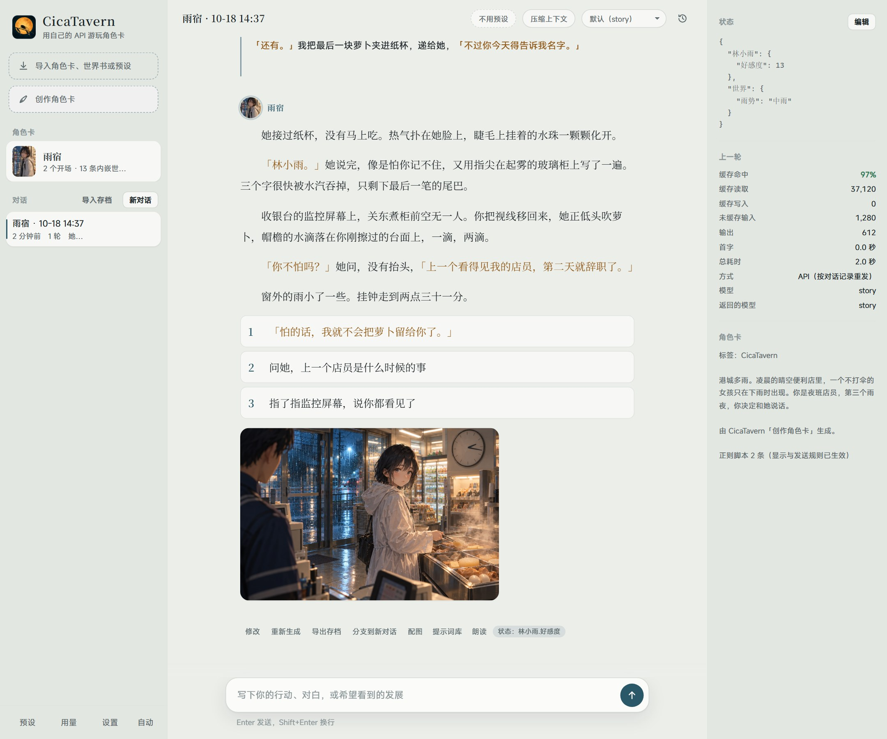

## Features

### High cache hit rates

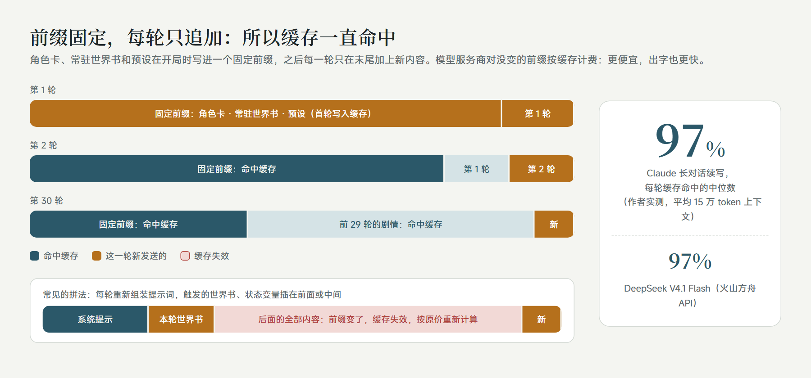

The card, world books and preset sit in a fixed prefix and each turn only appends, so a long chat hits the cache for over 90% of every turn.

### Long-term memory (Beta)

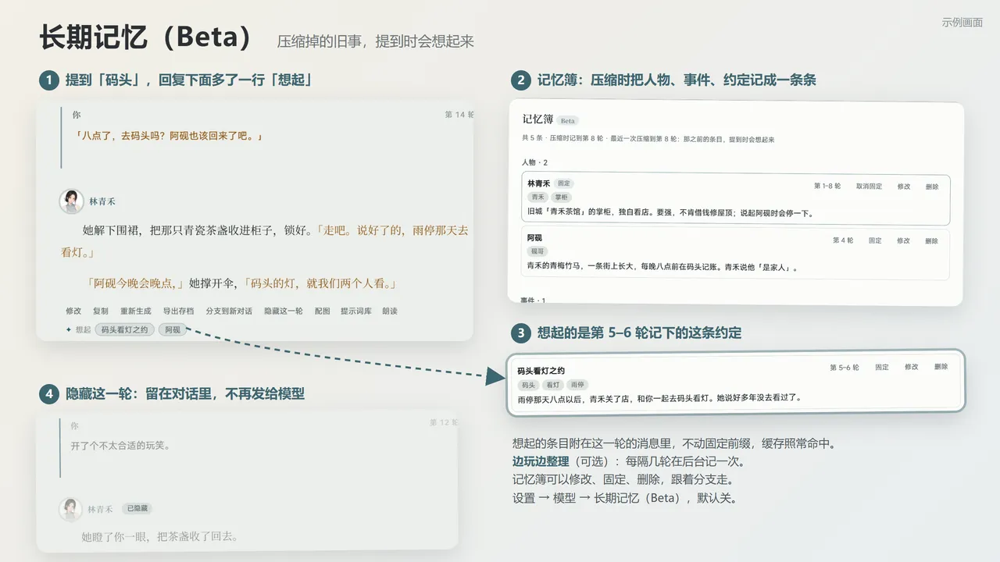

People, promises and foreshadowing from older parts of the story go into a memory book and come back when the story mentions them, without breaking the cache or needing any extra API.

### SillyTavern-compatible

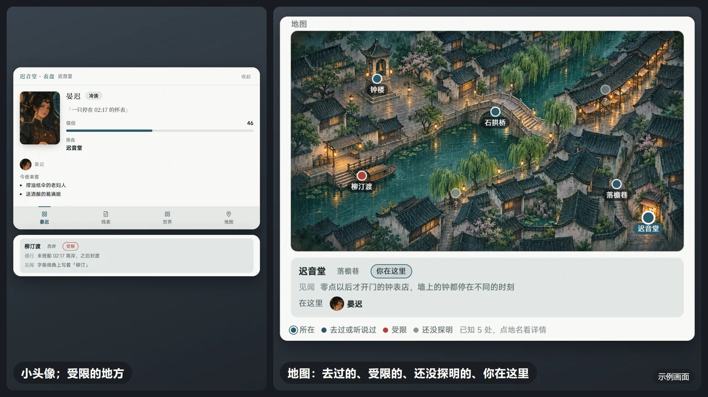

SillyTavern cards, world books, presets, regex, MVU variables, the status bars inside cards and Tavern Helper scripts all work, and SillyTavern chats import directly.

### Visual novel mode

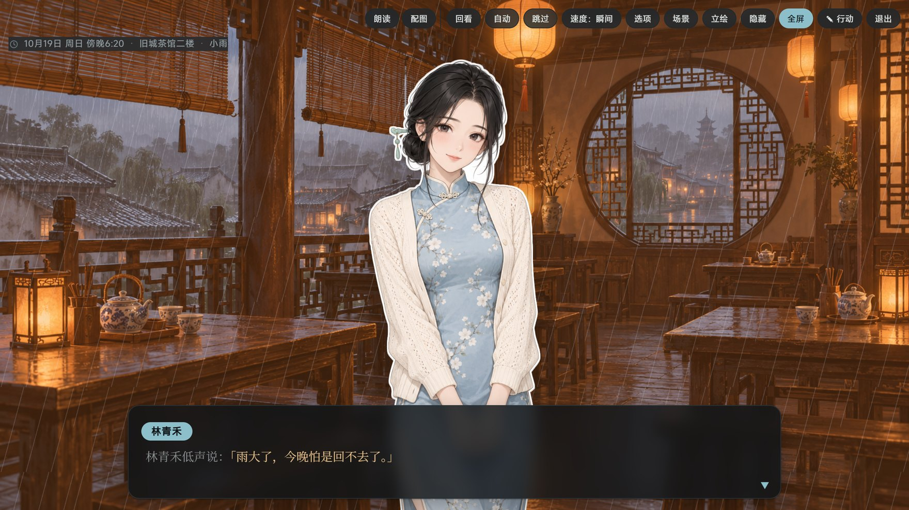

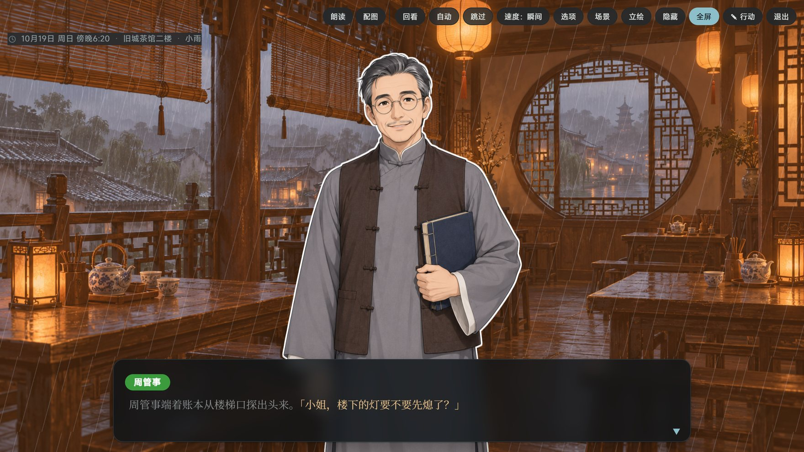 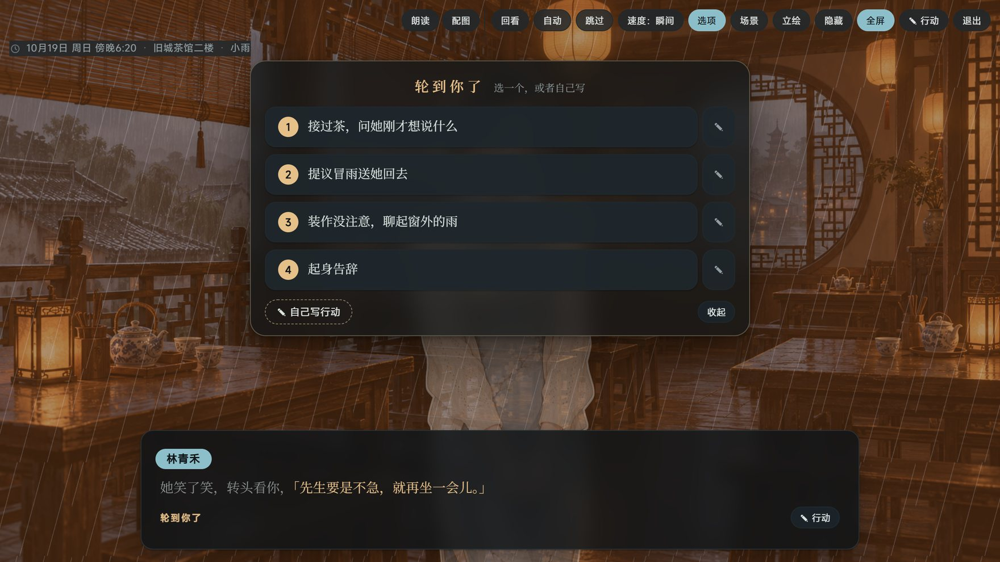

One switch turns the story into a game screen: scene backgrounds, the speaker's sprite, one line at a time, and the choices in the middle of the picture.

### Game rules mode (in development)

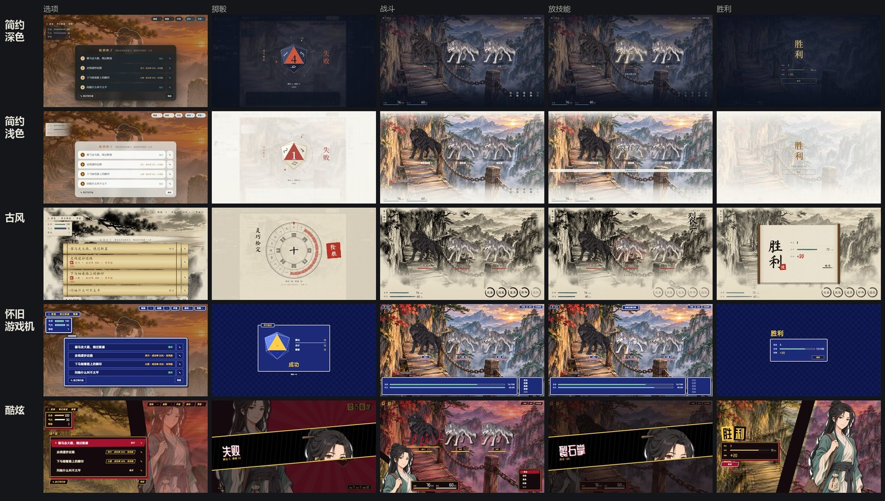

 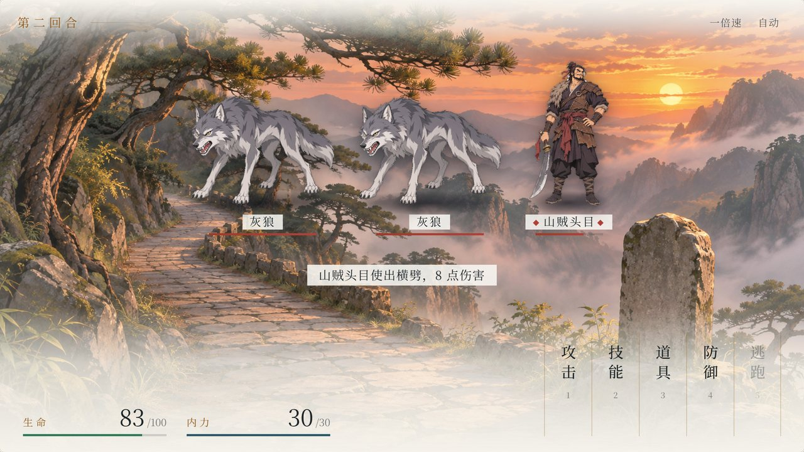

Dice checks, turn-based fights, levels and growth: the program decides what happens and the model writes it. On per card, off by default.

### Pictures, voices and characters that keep their look

Illustrate a scene with one click through an OpenAI-compatible API, Gemini, NovelAI, ComfyUI or SD WebUI. Read-aloud uses cloud voices, the browser's voices or a local model, and you can speak your messages too. Each character's face, outfit and voice are kept, so they stay the same person in every picture.

### Guided card creator

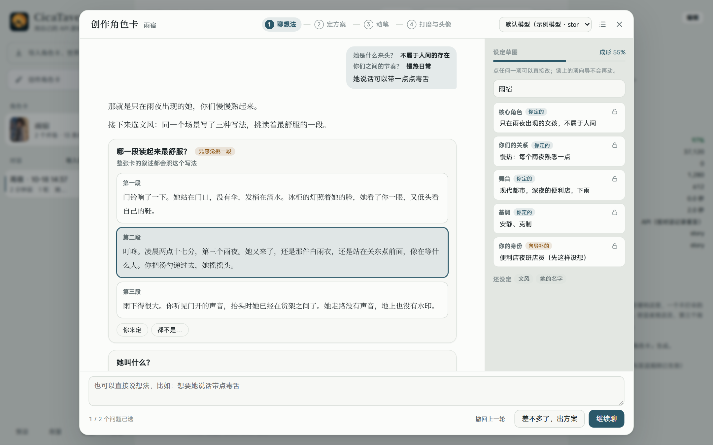

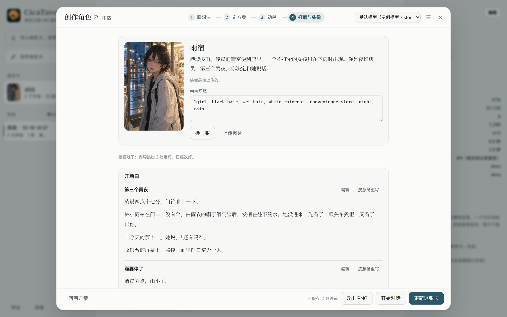

Not sure what you want yet? The creator asks you round by round, settles a plan with you, then writes the world book, greetings and status bar. The exported PNG works in SillyTavern too.

### On your computer and your phone

- With the computer on, open the passcode link in your phone's browser and play.
- Or install the Android app, or the iPhone and iPad [beta](https://testflight.apple.com/join/wsT7kT4b), and play without the computer.
- The interface is laid out for phone screens.

 

## Getting started (Windows)

1. Download the zip, unzip it anywhere and double-click **CicaTavern.exe**. If Windows says "Windows protected your PC" the first time, click **More info → Run anyway**.
2. At the bottom of the model picker in the top bar, choose 管理模型供应商… (Manage providers) → 添加 (Add) → 从模板开始 (Start from a template), pick a provider and paste your API key.
3. Top left, 导入角色卡、世界书或预设 (Import card, world book or preset): choose a SillyTavern card, then 新对话 (New chat).

Installing on Mac, Android and iPhone, and the full notes on updates, proxies, pictures, read-aloud, privacy and more, are in the **[user guide](docs/guide.en.md)**.

## Support the project

Building CicaTavern has taken over 20 billion tokens so far, and since October it has shipped 50+ versions in about a month.

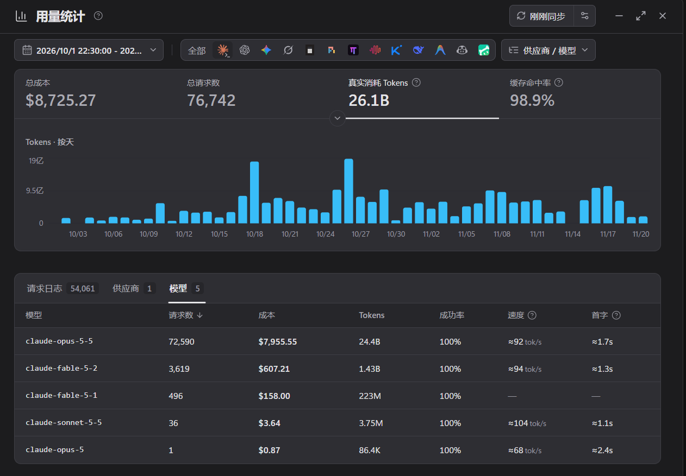

If you're having fun and would like to support the author, you can buy them a bubble tea. Thank you so much! With your support the updates will come even faster (ง •̀_•́)ง

Thank you all for your love and feedback; you are what keeps me going~

## License

[GNU AGPL-3.0](LICENSE), copyright Shikasar7. Free to use, commercial use included; a modified version you distribute must be open source too. Before contributing code, please read [CONTRIBUTING.md](CONTRIBUTING.md).

This project is not affiliated with Anthropic, OpenAI, Google or any other model provider; costs are billed to your own account. Character cards, world books and presets belong to their original authors.

# CicaTavern

**Agent 式的 SillyTavern 角色卡酒馆。** 导入酒馆的角色卡、世界书和预设，用**你自己的模型 API**（DeepSeek、OpenRouter、Anthropic、OpenAI、Gemini、本机 Ollama 等）跑剧情。

- **缓存命中高**：长对话也便宜，出字快。
- **长期记忆**：压缩掉的旧剧情，提到时会想起来。
- **兼容酒馆格式**：角色卡、世界书、预设、正则、MVU 变量和状态栏，导进来就能玩。
- **配图和朗读**：一键为剧情配图，对白和旁白各用一种音色。
- **视觉小说和游戏规则**：剧情变成游戏画面，还能掷骰、回合制战斗。
- **引导式创作角色卡**：一步步问你，最后写出一张完整的卡。

Windows、Mac、安卓、iPhone 都能用，界面有简体中文和英文，数据全部存在你自己的设备上。

<b><a href="https://github.com/Shikasar7/CicaTavern/releases/latest">下载最新版</a></b> · <a href="https://cnb.cool/cicatavern/CicaTavern/-/releases">国内镜像</a> · <a href="docs/guide.md">使用说明</a> · <a href="docs/help/README.md">帮助</a> · <a href="CHANGELOG.md">更新记录</a>

## 功能

### 缓存命中高

角色卡、世界书和预设放在固定的前缀里，每轮只往后追加，长对话每轮的缓存命中在九成以上。

### 长期记忆（Beta）

旧剧情里的人物、约定和伏笔记进「记忆簿」，剧情再提到时自动想起。不破坏缓存，也不需要额外的接口。

### 兼容酒馆

SillyTavern 的角色卡、世界书、预设、正则、MVU 变量、卡里的状态栏和酒馆助手脚本都能用，SillyTavern 的对话记录也能直接导入。

### 视觉小说模式

 

一键把剧情变成游戏画面：场景背景、说话人的立绘、一句一句地读，选项在画面中央弹出。

### 游戏规则模式（开发中）

 

掷骰检定、回合制战斗、升级和成长，成败由程序算，模型只负责把结果写好。按卡开启，默认关。

### 配图、朗读和固定的形象

一键为剧情配图，支持 OpenAI 兼容接口、Gemini、NovelAI、ComfyUI 和 SD WebUI。朗读支持云端音色、浏览器音色和本机模型，也能语音输入。每个角色的长相、衣着和音色都记下来，画多少张都是同一个人。

### 引导式创作角色卡

说不清想要什么也没关系，向导一轮轮问你，定好方案后写出世界书、开场白和状态栏，导出的 PNG 在 SillyTavern 里也能用。

### 电脑和手机都能玩

- 电脑开着时，手机浏览器打开带口令的链接就能玩。
- 也可以装安卓版，或者用 iPhone、iPad 的[测试版](https://testflight.apple.com/join/wsT7kT4b)，不用开电脑。
- 界面专门适配了手机屏幕。

 

## 快速开始（Windows）

1. 下载 zip，解压到任意位置，双击 **「CicaTavern.exe」**。第一次打开时 Windows 可能提示「Windows 已保护你的电脑」，点「更多信息 → 仍要运行」。
2. 顶栏模型选择最下面的「管理模型供应商…」→「添加」→「从模板开始」，选一家，粘贴 API Key。
3. 左上「导入角色卡、世界书或预设」，选 SillyTavern 的角色卡，点「新对话」开始。

Mac、安卓、iPhone 的安装，以及更新、代理、配图、朗读、隐私等完整说明见 **[使用说明](docs/guide.md)**。

## 赞赏

本项目开发至今已花费 200 亿 + token，从 10 月开始几十天里更新了 50+ 个版本w

如果您玩得开心，也想支持一下作者的话，可以请作者喝杯奶茶嘿嘿，万分感谢！有了您的支持，作者一定小皮鞭抽自己加速更新 (ง •̀_•́)ง

感谢大家一直以来的喜爱和反馈，你们就是我持续努力的最大动力~

## 许可证

[GNU AGPL-3.0](LICENSE)，版权归 Shikasar7 所有。免费使用，也可以商用；修改后再发布要同样开源。提交代码前请看 [CONTRIBUTING.md](CONTRIBUTING.md)。

本项目与 Anthropic、OpenAI、Google 等模型服务商没有关联，费用按你自己的账号计费。角色卡、世界书、预设的版权归原作者所有。
